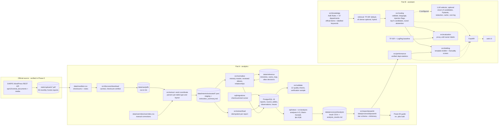

# DESIGN.md — Decision Log

## Project summary

**CPGRAMS Grievance Intelligence Platform.** It has two connected parts:

- **Part A — Grievance analytics.** Extracts, validates and analyses DARPG's public *CPGRAMS Monthly Report – Central
  Ministries/Departments* PDFs (Report #1, May 2022, to #53, September 2026). The outputs are a provenance-preserving
  PostgreSQL dataset, reproducible SQL and statistical analyses, and Power BI-ready exports.
- **Part B — AI complaint routing and drafting assistant.** For English, Hindi and Hinglish input, it suggests the
  responsible ministry/department from verified mandate data, asks clarifying questions or abstains when evidence is
  weak, drafts a complaint containing only user-supplied facts, and shows verified historical department-level
  statistics from Part A. The user always submits on the official CPGRAMS portal themselves.

Current phase: **All 13 phases built (2026-10-22).** Part A: analyses A-G, a
within-group scorecard and 15 validated Power BI export tables (no Power BI report built; 12-value sample verified by the assistant, 12/12). Part B: a 37-department knowledge base from the official Allocation of Business
Rules; synthetic development and evaluation sets (labelled by the assistant, not independent); an offline router (retrieval + tuned
rules) and a baseline, both evaluated; an LLM selector built but not run (no API key); a
template drafter with a factuality screen; a FastAPI app with an accessible web page (verified locally in
headless Chrome); final documentation (README, docs/report.md, docs/portfolio.md). Pending the owner:
the decision to enable the LLM, and independent human versions of the checks the assistant performed at the
owner's request (D-047): sample verification, labels, draft ratings, knowledge-base review.

## Architecture overview

Proposed architecture. Solid lines are built or verified; dashed lines are planned.

## Decisions

### D-001: Discover reports through the public WordPress REST API, not the front-end or legacy URLs
- Date / Phase: 2026-10-21 / Phase 0
- Context: www.darpg.gov.in is a statically exported Next.js app that loads its content client-side, so the HTML has no
  report links. Legacy Drupal URLs (`sites/default/files/YYYY-MM-01.pdf`) return 404. The front-end JS bundle contains
  an API key for a custom `/ccms/` endpoint.
- Options considered: (1) scrape the rendered pages with a headless browser; (2) call the custom endpoint with the key
  embedded in the bundle; (3) use the standard, unauthenticated WordPress `wp/v2` endpoints (`search`,
  `central_documents`, `media`); (4) ask the user to download PDFs manually.
- Decision: Option 3, with Option 4 as the fallback if the API becomes unavailable.
- Why: It returns structured metadata (post ID, title, media ID, file size, source URL), needs no credentials, and
  `robots.txt` allows all paths. Using a key that was meant for the site's own front-end could be read as bypassing an
  access control (Rule 8), so it was not used.
- Trade-offs / risks: Undocumented API; it could change or be restricted. Mitigated by caching every PDF, storing
  checksums, and snapshotting the catalogue (`data/reference/phase0_cms_catalogue_snapshot.json`).
- Revisit if: `wp/v2` stops responding, or DARPG publishes an official dataset or API.
- Interview talking point: "When the site had no links in its HTML, I traced the SPA's build manifest to find its CMS
  backend, then deliberately used only the unauthenticated public endpoints."

### D-002: Analyse only the English "Central Ministries/Departments" series #1–#53
- Date / Phase: 2026-10-21 / Phase 0
- Context: The CMS mixes Centre, States/UTs, RTI, NeSDA and Secretariat Reforms reports. Hindi-only uploads exist for
  #43 and #45, and English versions of both were also found.
- Options considered: Centre only; Centre + States/UTs; include Hindi editions.
- Decision: Centre series only, English editions canonical. Keep the Hindi PDFs on disk with checksums, but do not
  extract from them.
- Why: The project is about central ministries. English editions exist for all 53 months. The Hindi text layer uses
  legacy font encoding and is unreliable.
- Trade-offs / risks: The States/UTs series is left for future work.
- Revisit if: A States/UTs comparison is approved.
- Interview talking point: Scoping to one consistent series is what makes longitudinal claims defensible.

### D-003: Identify each report by its content, not by CMS metadata
- Date / Phase: 2026-10-21 / Phase 0
- Context: CMS titles are inconsistent or wrong (3 entries were other report types), `file_date` is sometimes wrong,
  and 17 entries are byte-size duplicates.
- Decision: Assign `report_month`/`report_number` only after reading the cover or highlights text. Deduplicate by byte
  size, then SHA-256, then text comparison. Flag numbers inferred from the sequence.
- Why: Metadata errors would silently corrupt the time series.
- Trade-offs / risks: 17 presumed duplicates were not downloaded, so their checksums are not verified.
- Revisit if: The Phase 2 downloader sees a different size or checksum for a known URL.
- Interview talking point: "I treated source metadata as untrusted input and validated it against document content."

### D-004: Use the physical PDF page as the primary provenance key
- Date / Phase: 2026-10-21 / Phase 0
- Context: Printed page labels differ from physical pages by 0, −1 or −2 depending on the era.
- Decision: Store `pdf_page` (1-based physical index) as the primary key and `printed_page_label` as a secondary field.
- Why: A reviewer opening the PDF in any viewer can jump straight to the physical page number.
- Trade-offs / risks: Physical pages change if DARPG re-uploads a modified file. The checksum detects that.
- Revisit if: Never, unless a different viewer convention is required.
- Interview talking point: A small provenance detail that makes every number auditable.

### D-005: Model ministry annexure values as year-to-date stocks and flows, never as monthly flows
- Date / Phase: 2026-10-21 / Phase 0
- Context: Ministry annexures report BF (1 Jan), receipts and disposal since 1 Jan, and pending at the cut-off date.
  The identity BF + R − D = Pending was verified on one row.
- Decision: The schema stores `period_start`, `period_end` and `measure_type` (stock vs cumulative flow) for each
  observation. Monthly ministry flows are derived only by differencing within one calendar year and are labelled as
  project-derived.
- Why: Treating YTD receipts as monthly receipts would inflate later months many times over.
- Trade-offs / risks: Differencing works only for ministries present in consecutive months (the lists are censored).
- Revisit if: The GRAI per-ministry monthly tables (D-007, T6) are extracted successfully.
- Interview talking point: Understanding a metric's reference period before analysing it.

### D-006: Make definition changes explicit columns, and use Apr 2023–Sep 2026 as the core statistical window
- Date / Phase: 2026-10-21 / Phase 0
- Context: Cut-off date (25th until Mar 2023, then month-end, with 28 Mar 2025 as an exception); long-pending
  threshold (45/30/21 days); GRAI methodology (GRI at #4, 4-dimension GRAI by #16, normalisation removed at #46);
  Group A threshold (>2,500, then ≥500).
- Decision: Carry `cutoff_date`, `threshold_days`, `grai_methodology_version` and `group` as data. Run trend tests
  only on the 42 month-end points (Apr 2023–Sep 2026). Show earlier data descriptively, with a break marker.
  **Approved by the user, 2026-10-21 (start of Phase 1).**
- Why: Mixing definitions would create artificial trends.
- Trade-offs / risks: Statistical power is lower than with 53 points.
- Revisit if: DARPG publishes back-cast month-end figures for 2022.
- Interview talking point: Detecting structural breaks in an administrative time series.

### D-007: Recommended analytics scope — core tables T1–T5, stretch T6, drop category and seasonality claims
- Date / Phase: 2026-10-21 / Phase 0
- Context: See `docs/source_inventory.md` §9.
- Decision (**approved by the user, 2026-10-21**; appeals were also approved as an optional analysis, see D-014):
  - T1 overall monthly receipts, disposal, pending (aggregate)
  - T2 >1000-pending list membership and values (53 months)
  - T3 long-pending Top-10 with `threshold_days`
  - T4 high/low average closing time (Top-/bottom-10, YTD)
  - T5 GRI/GRAI score and rank, with group and methodology version
  - T6 (stretch) per-ministry monthly BF/R/D/P for all ranked ministries, from the GRAI tables (~#28 onward).
    Piloted on 3 reports in Phase 2 and adopted only if validation passes.
  - Dropped: category-level analysis (only #1–#3 have tables), seasonality claims, appeals/feedback/CSC.
- Why: It keeps the project to what is consistently published, and T6 gives a credible upgrade path.
- Trade-offs / risks: Without T6, ministry-level analyses cover only ministries above the 1000-pending threshold.
- Revisit if: The T6 pilot succeeds or fails.
- Interview talking point: Scoping analyses to the evidence instead of to the original wish-list.

### D-008: Keep raw PDFs out of Git, and make them reproducible from the manifest
- Date / Phase: 2026-10-21 / Phase 0
- Context: 55 PDFs, about 140 MB, which are government-hosted files.
- Decision: `data/raw/` goes in `.gitignore` (Phase 1). `data/manifest.csv` holds the URL and SHA-256 for each file.
  The Phase 2 downloader re-fetches and verifies them. **Approved by the user, 2026-10-21.**
- Why: Keeps the repository small and avoids redistributing bulk files. The copyright policy permits reproduction
  with attribution, but the files are not needed in the repo.
- Trade-offs / risks: Reproduction depends on the URLs staying live. The checksums detect any change.
- Revisit if: The URLs start failing, in which case consider a release asset with attribution.
- Interview talking point: Reproducibility through manifests and checksums.

### D-009: Predictable raw filename convention
- Date / Phase: 2026-10-21 / Phase 0
- Decision: `cpgrams_centre_<YYYY-MM>_r<NN>_<lang>.pdf`. The CMS media ID is kept in the manifest.
- Why: Sortable, self-describing, and stable across re-uploads.
- Interview talking point: Naming encodes the primary key.

### D-010: Long-format `observations` fact table as the source of truth; wide views later
- Date / Phase: 2026-10-21 / Phase 1
- Context: The Phase 1 brief suggested wide tables (`monthly_overall`, `ministry_monthly`, `ministry_rankings`).
  But the metric set differs by table type and era. Every value needs its own page, original label and validation
  status. Reference periods differ (single month vs YTD), and so do thresholds (45/30/21 days) and GRAI methodology.
- Options considered: (1) one wide table per metric family; (2) a long table, with one row per published value and
  the table-level context in `source_tables`; (3) store raw JSON per table.
- Decision: Option 2. `reports` → `source_tables` (page range, period, threshold, GRAI group/methodology,
  parser version) → `observations` (original text, parsed number, period, page, validation status). The suggested
  wide tables become SQL views in Phase 4. Metric meanings live in `metric_definitions`, and the `is_official` flag
  separates DARPG's figures from project-derived ones.
- Why: Provenance and definition changes are represented uniformly. A new table type needs no schema change.
  Constraints encode Phase 0 rules: the cut-off must fall in the report month, threshold tables must have a
  threshold, GRAI tables must have a group and methodology, published values must be non-negative, and fuzzy
  aliases need a reviewer. Table-level constraints are named (e.g. `ck_reports_cutoff_in_month`), so pipeline
  errors are self-explanatory.
- Trade-offs / risks: Analysis queries need pivots or views, and `numeric(14,4)` is generic. Accepted for the
  sake of auditability.
- Revisit if: View performance becomes a problem. It won't at this scale: tens of thousands of rows.
- Interview talking point: Why a long fact table with a table-context dimension suits messy, versioned
  administrative data, and how CHECK constraints make invalid states unrepresentable.

### D-011: Pinned requirements files, with dependencies added only when a phase needs them
- Date / Phase: 2026-10-21 / Phase 1
- Options considered: Poetry or uv lockfiles; pip-tools; plain pinned `requirements.txt`.
- Decision: `requirements.txt` (runtime) and `requirements-dev.txt` (pytest, ruff), with exact `==` pins and a
  comment on why each package exists. `pyproject.toml` holds only tool configuration. Phase 1 installs only
  SQLAlchemy, psycopg2-binary, pydantic and python-dotenv. pdfplumber and the rest arrive in the phase that uses
  them.
- Why: Familiar to every reviewer, works with plain pip on Windows, and matches the "don't install the whole stack
  blindly" rule.
- Trade-offs / risks: Transitive dependencies aren't locked. Acceptable for a portfolio project; revisit with
  pip-tools if a transitive break happens.
- Revisit if: A transitive dependency causes a reproducibility failure.
- Interview talking point: Choosing the simplest tool that keeps installs reproducible.

### D-012: Numbered SQL migrations with a small checksummed runner (departure from a single `sql/schema.sql`)
- Date / Phase: 2026-10-21 / Phase 1
- Context: The target structure lists `sql/schema.sql`. But the schema will grow: T6 tables, appeals, the
  mandate knowledge base in Phase 7, and app tables. Reviewers need to recreate it exactly.
- Options considered: one `schema.sql` that is dropped and recreated each time; Alembic; a minimal runner over
  `sql/migrations/NNNN_name.sql`.
- Decision: The minimal runner (`src/db.py`, about 60 lines). Each file runs in its own transaction and is recorded
  in `schema_migrations` with its SHA-256. If an applied file has changed, the runner refuses to continue.
- Why: Plain SQL stays readable and reviewable, unlike Alembic's Python DSL and extra concepts. Edits to applied
  files are detected, and the runner is easy to explain.
- Trade-offs / risks: No down-migrations. The reset procedure is `docker compose down -v`, then re-running
  migrations. Fine for a local, reproducible pipeline.
- Revisit if: Multiple people deploy to a shared database.
- Interview talking point: Why checksum verification matters, and why "never edit an applied migration".
  (0001 was renamed for its constraints before it had ever been applied to a persistent database.)

### D-013: Docker unavailable on the dev machine — verify against real PostgreSQL anyway; isolate tests by schema
- Date / Phase: 2026-10-21 / Phase 1
- Context: Docker Desktop and WSL2 are not installed. Port 5433 is already used by another local project's
  embedded PostgreSQL, which was left untouched.
- Decision: Keep Docker Compose as the documented setup, as in the brief's proposed stack. The compose file uses image
  `postgres:16.4`, is bound to 127.0.0.1 only, defaults to host port 5432 (configurable via `POSTGRES_HOST_PORT`),
  and has a healthcheck. For verification in Phase 1, the real migrations and tests ran against a throwaway
  PostgreSQL **16.2** server: the `pgserver` wheel's binaries, outside the project, on port 5434. Integration tests
  are opt-in (`TEST_DATABASE_URL`). They create a random temporary schema, apply the migrations via `search_path`,
  and drop it afterwards.
- Why: Rule 11 requires real verification. Schema isolation lets the tests run safely against the dev database.
- Trade-offs / risks: The Docker path itself (`docker compose up` and the healthcheck) is **not yet executed** on
  this machine. The YAML was only parse-checked. 16.2 vs 16.4 is a minor-version difference with no relevant
  feature changes. `UNIQUE NULLS NOT DISTINCT` requires PostgreSQL ≥15.
- Revisit if: Docker Desktop is installed. Then run the README setup and record the result here.
- Interview talking point: Verifying a schema against the real engine, not a mock, and keeping tests isolated
  from dev data.

### D-014: Appeals data approved as an optional analysis
- Date / Phase: 2026-10-21 / Phase 1 (user answer to Phase 0 open question 4)
- Decision: Appeals metrics (month-wise receipts/disposal/pending, Top-10 appeal pendency) may be extracted after
  T1–T5. Their metric codes will be added to `metric_definitions` in a new migration when they are extracted.
- Why: Published consistently and cheap to add, but not core to the routing assistant.
- Revisit if: Phase 2 time runs short. Appeals are the first thing to drop.

### D-015: Parse tables from word coordinates, not pdfplumber's table detection
- Date / Phase: 2026-10-21 / Phase 2
- Context: The tables have no ruling lines, only shaded header rectangles. `page.find_tables()` produced spurious
  empty columns, **truncated ministry names** ("Department of Financial Services (Insu") and split wrapped names into
  separate rows (observed on #16, #40, #53).
- Options considered: pdfplumber `find_tables`; camelot (lattice needs ruling lines; stream mode is similar to
  text parsing, and needs Ghostscript); OCR (the text layer is good, so OCR would only add errors); word coordinates.
- Decision: Word coordinates (`extract_words`), grouped into visual lines (3.2 pt tolerance). Each row is anchored on
  the line that starts with its serial number and carries its figures. Wrapped name lines are assigned to anchors
  (D-019). Columns are mapped by an explicit, header-checked layout per table type and era: 4 GRAI layouts plus 2
  one-off variants (#15, #26), and flow tables with or without a Total column.
- Why: Gives full names and exact cells, and every failure surfaces as an issue (column count, header, serial gap).
- Trade-offs / risks: Layout knowledge lives in code. A new layout fails loudly (`unexpected_header`), not silently.
- Revisit if: DARPG changes the PDF generator again.
- Interview talking point: Why I didn't trust the table detector's output, and how anchor rows plus explicit
  layouts make every misparse visible.

### D-016: Identity tolerance: keep small published arithmetic gaps as `warning`, fail large ones
- Date / Phase: 2026-10-21 / Phase 2
- Context: In 44 of ~4,600 ministry rows, Total - Disposal differs from Pending by 1-3 grievances (26 by +1, 13 by
  -1, 2 by +2, 1 by -2, 2 by -3), while BF + Receipts = Total always held. The same off-by-one Pending appears in two
  independent tables of #27 (>1000 annexure and GRAI table). So these are source inconsistencies, not misreads.
- Decision: |gap| <= 3 (`IDENTITY_TOLERANCE`) gives status `warning` plus a `source_identity_gap` issue that records
  the gap. Larger gives `failed` plus `identity_failed`. Exact gives `valid`. The threshold comes from the observed
  distribution.
- Why: Marking faithful transcriptions as failed would push analysts to drop correct data.
- Trade-offs / risks: A real misread of 3 or less (e.g. one digit misread in the units place) would pass as a
  warning. Visual verification in Phase 3 covers this risk partially.
- Revisit if: Any gap above 3 appears in new reports.
- Interview talking point: Distinguishing extraction errors from source-data inconsistencies with evidence.

### D-017: T6 decision: adopt the GRAI flow panel (Jun 2024 - Jan 2026); reject the 2026 "Data Used" tables
- Date / Phase: 2026-10-21 / Phase 2 (pilot required by D-007)
- Context and evidence (docs/extraction_verification.md section 3):
  - #26-#45 GRAI tables print monthly BF/Receipts/Disposal/Pending for about 90 ministries. Month-end Pending matched
    the independent >1000 annexure for **313 of 316** ministries (the other 3, all in #43, differ by 1).
    *Corrected in Phase 3: first recorded as 323 of 326, an addition error. By canonical ministry: 315 of 318.*
  - #49-#53 "Data Used for Score Calculation" tables have no serials, ~21 columns, and no Disposal or Pending for
    grievances. A pilot on #49, #50 and #53 (Group A) matched annexure-derived values in **1 of 91** comparisons
    (median ratio 0.953).
- Decision: The GRAI flow columns are part of the pipeline (they are already in the `grai_ranking` tables, flagged by
  `grai_methodology` = `GRAI_4D_flows` / `GRAI_4D_total_flows`). The "Data Used" parser stays as a reproducible pilot
  (`python -m src.extract.grai_inputs`) and is not loaded.
- Why: Adopt only what validates against an independent table.
- Trade-offs / risks: The full ministry panel covers 20 months only. Outside it, ministry-level data is limited to
  the threshold- and rank-censored lists.
- Revisit if: DARPG documents the "Data Used" definitions, or restores flow columns to the ranking tables.
- Interview talking point: Validating a new data source against an independent one before using it, and walking
  away when it fails.

### D-018: Month-wise aggregate series only from printed data tables; chart-only pages are skipped
- Date / Phase: 2026-10-21 / Phase 2
- Context: Some reports show the monthly series only as a line chart (#2) or as bar charts with labels ordered by
  bar height (#28-#32), so a value cannot be tied to a series from the text alone.
- Decision: Parse only pages that print `Receipts|Received`, `Disposal`, `Pending|Pendency` rows with a month-label
  row. Month labels set the dates: some reports use rolling 6-month windows, and years are assigned backwards from
  the report month. The 13 chart-only reports are listed in `NO_CLEAN_MONTHWISE`.
- Why: A survey showed every month from Jan 2022 to Sep 2026 is covered by at least one clean table, usually by
  several, which also enables cross-report checks in Phase 3.
- Trade-offs / risks: Values for a month come from a later report than the month's own. Revisions between reports
  are possible and will be measured in Phase 3.
- Interview talking point: Choosing a less clever but verifiable source over parsing charts.

### D-019: Assign wrapped name lines by the largest vertical gap, with table-level alignment detection
- Date / Phase: 2026-10-21 / Phase 2
- Context: A first "nearest anchor" rule produced names such as "Department of Posts Department of" and
  "Agriculture Department Research and of". A scan of all names found 22 suspicious names out of 174.
- Decision: Lines between two anchors are split at the largest gap, because row padding exceeds intra-cell line
  spacing (2022: ~12 vs ~15.5 pt; narrow 2026 GRAI tables: 16.2 vs 16.7 pt). When gaps tie, a page whose clear
  splits all go to the row above is treated as top-aligned (2022). Otherwise the nearest anchor wins. Merged
  two-line anchors keep reading order and are measured from their lowest line. Lines that open a continuation page
  are split off as the tail of the previous page's last row when a boundary-sized gap follows them.
- Result: 1 suspicious name left (a mid-word split) and 121 distinct printed names; every rule has a unit test on
  a synthetic layout (tests/test_rows.py).
- Trade-offs / risks: The 0.5 pt margin in 2026 tables is narrow but consistent. The name scan is part of the
  verification routine.
- Interview talking point: Using geometry (padding vs line spacing) instead of heuristics on words.

### D-020: Downloader uses the standard library; discovery only reports
- Date / Phase: 2026-10-21 / Phase 2
- Decision: `urllib` with retries and backoff, a 3 s delay between requests, and host/path allow-listing
  (`https://www.darpg.gov.in/static/uploads/`). A file is kept only if it starts with `%PDF` and matches the
  manifest SHA-256 (atomic write), and a cached file is never fetched again. `--discover` scans the CMS (330
  entries) and lists unknown Centre entries. It never edits the manifest (D-003), and it fails if the API is
  unreachable rather than reporting "nothing new".
- Why: No new dependency is needed for sequential GETs, and a changed upstream file needs human review.
- Interview talking point: Safe, reproducible acquisition: allow-lists, checksums, atomic writes, no silent zeros.

### D-021: Extraction writes staging JSON; a separate idempotent loader writes PostgreSQL
- Date / Phase: 2026-10-21 / Phase 2
- Decision: `python -m src.extract.run` writes one JSON file per report and a generated
  `docs/extraction_summary.md`. `python -m src.extract.load` upserts each report by checksum, deletes its previous
  tables (cascade) and inserts the new ones in one transaction. Manual corrections are applied between the two
  steps from `data/overrides/overrides.csv`. Each override needs a reason and a reviewer, the extracted text is
  kept, and an unmatched override is an error.
- Why: Extraction doesn't need a database (Docker is unavailable here, D-013), staging files are diffable between
  parser versions, and re-loading never duplicates rows (verified: two loads, identical counts).
- Interview talking point: Separating parse from load, and making ingestion safe to re-run.

### D-022: Appeals extraction deferred
- Date / Phase: 2026-10-21 / Phase 2 (applies D-014's "revisit if")
- Decision: Not extracted in Phase 2. T1-T5 and the T6 pilot took priority. Appeals remain optional for a later
  phase.

### D-023: Two-tier ministry name resolution; fuzzy similarity proposes, a person decides
- Date / Phase: 2026-10-21 / Phase 3
- Context: 121 printed names. Most differences are formatting (7 spellings of "Department of Telecommunications"
  produced by words broken across lines), some are spelling or renames, and some look similar but are different
  bodies (Defence vs Defence Finance; Banking vs Insurance Division).
- Options considered: fuzzy matching with an acceptance threshold; a hand-made mapping of all 121 names; two tiers.
- Decision: Tier 1 is formatting-only cleaning (automatic, unit-tested). Tier 2 is alias decisions in
  `data/reference/ministry_aliases.csv`, each with evidence, reviewer and date. Fuzzy similarity and
  identical-figure detection only create review proposals. A pair printed in the same table is automatically
  distinct. Undecided names stay unmapped instead of becoming duplicate entities. The canonical name is the
  form printed most recently.
- Result: 92 entities, 0 unresolved, 10 decisions (accepted by the project owner), 0 duplicate observations
  within any table after merging (check C04).
- Why: Brief Rules 3.5-3.7. A wrong merge silently corrupts every ministry series; an unmapped name is visible.
- Trade-offs / risks: 8 of the decisions rest on naming evidence rather than proven figure identity.
- Revisit if: a later report prints two merged names in the same table (C04 would flag it).
- Interview talking point: Using co-occurrence and figure identity as evidence in entity resolution, so fuzzy
  scores never decide on their own.

### D-024: Similarity on distinguishing words, threshold 85, calibrated on known pairs
- Date / Phase: 2026-10-21 / Phase 3
- Context: RapidFuzz `WRatio` on full names scored unrelated names at 85.5 (partial matches on "Ministry of"),
  producing 556 proposals.
- Decision: Remove generic words (ministry, department, of, and, the, for, o/o) and use `token_sort_ratio`,
  proposing at >= 85. Known same bodies scored >= 86.7; known different bodies <= 75. Renames whose names
  differ (CBEC -> CBIC, 78.1) are caught by the identical-figures route instead.
- Interview talking point: Calibrating a threshold on labelled pairs instead of choosing a round number.

### D-025: Reorganisations are relationships, not aliases
- Date / Phase: 2026-10-21 / Phase 3
- Decision: Migration 0003 adds `ministry_relationships` (renamed_to / split_into / merged_into, with evidence).
  The MoHUA split into the Department of Urban Development (report #53 note) is recorded. The two series are
  never joined as if continuous. Migration 0003 also moves alias uniqueness from the cleaned key to the printed
  spelling, adds `ministry_key`, and adds the first and last report months.
- Interview talking point: Modelling organisational change explicitly in a time series.

### D-026: One value per month for the aggregate series: the latest report that prints it
- Date / Phase: 2026-10-21 / Phase 3
- Context: Check C06 found 49 month-metric values printed differently across reports. 2022 reports recompute
  past months; before Apr 2023 a report's own month is partial (cut-off on the 25th: Jul 2022 receipts were
  77,414 in its own report vs 96,536 later, ratio 0.80); #14 restated Jan-May 2023 once.
- Options considered: first-published value; value from the month's own report; latest-published value.
- Decision: The analysis uses the latest-published value per month (a complete month, the most revised); every
  printed value stays in `observations` with provenance. A pre-Apr-2023 report's own month is never used.
- Trade-offs / risks: Latest is not necessarily "true". 2022 values remain descriptive (D-006).
- Interview talking point: Detecting silent revisions in administrative data and choosing a vintage rule.

### D-027: Detect stale reprints automatically; flag, do not delete
- Date / Phase: 2026-10-21 / Phase 3
- Context: #41 (Sep 2025) prints #40's average-closing-time annexures unchanged (20/20 values) under a
  heading claiming data to 30 Sep 2025.
- Decision: After extraction, any table identical value-for-value to the same table in the previous report gets
  an `identical_to_previous_report` warning, and its observations become `warning`. This runs on all tables;
  only those 2 of 387 are flagged. Analyses exclude flagged tables from period-specific results.
- Interview talking point: A generic consistency rule found a publisher error that no per-row check could see.

### D-028: Analysis views are re-created on every run, not versioned as migrations
- Date / Phase: 2026-10-21 / Phase 4
- Decision: `sql/views/NN_*.sql` hold `CREATE OR REPLACE VIEW` statements, applied in order by
  `python -m src.analysis.run` (`src/analysis/views.py`). Migrations stay for objects that hold data.
- Why: Views hold no data and evolve with the analyses. Versioning each edit as a migration would add noise
  without protecting anything.
- Trade-offs / risks: Dropping a column that a view depends on needs the view updated in the same change.
  `tests/test_views.py` covers the most consequential view (latest-value selection, partial-month flag).

### D-029: Mann-Kendall with Hamed-Rao correction (pre-whitening fallback), Sen's slope, BH FDR per family
- Date / Phase: 2026-10-21 / Phase 4
- Context: Monthly administrative series are autocorrelated, and the original Mann-Kendall test then overstates
  significance. 99 trend tests are run (4 aggregate, 5 + 90 ministry-level).
- Options considered: OLS slope with t-test (assumes normal, independent residuals); original Mann-Kendall;
  autocorrelation-corrected Mann-Kendall.
- Decision: The p-value used is Hamed-Rao modified; where its corrected variance is negative (1 of 99 tests),
  trend-free pre-whitening (Yue et al. 2002) is used, recorded in `p_method`. Effect size is Sen's slope (and %
  of the mean). Benjamini-Hochberg q < 0.05 within each test family. Gap-free series only; minimum lengths in
  `src/analysis/config.py`.
- Why: Rank-based (robust to the 2024 Rural Development spike), honest about autocorrelation, and it controls
  false discoveries across 90 ministries.
- Trade-offs / risks: Mann-Kendall detects monotonic trends only; a rise then a fall can look like "no trend".
- Interview talking point: Why the original Mann-Kendall p-value is too optimistic for monthly data, and how FDR
  differs from Bonferroni.

### D-030: Rankings are compared only between consecutive reports of the same layout era and group threshold
- Date / Phase: 2026-10-21 / Phase 4
- Context: The GRI/GRAI method, layout, group thresholds and indicator set changed several times (#4-#53).
- Decision: Spearman rho, rank change and top-5 retention only for adjacent reports with an equal layout era
  and threshold. Non-comparable pairs are listed with the reason. No long-run rank trends.
- Interview talking point: Comparability before computation.

### D-031: Demand vs backlog uses a gap-free single-month window and a stated band, with sensitivity analysis
- Date / Phase: 2026-10-21 / Phase 4
- Decision: T6 panel #29-#45 (Sep 2024 - Jan 2026; #28's flows cover two months and are not split by
  assumption). The relative Sen slope of receipts and of month-end pending is classified rising / stable /
  falling at ±1% of the mean per month. Ministries below 100 receipts/month or 50 mean pending are
  "insufficient volume". Bands of 0.5% and 2% are re-run: 58 and 51 of 66 ministries keep their quadrant.
- Why: The brief requires defined thresholds and forbids equating demand with poor performance; the
  sensitivity table shows how much the labels depend on the choice.

### D-032: Scorecard: within-group percentiles of four published indicators, missing never zero
- Date / Phase: 2026-10-21 / Phase 5
- Context: The brief allows a scorecard only if the data justify it. Published average closing time exists only
  for the top/bottom 10; the > 1,000 list is size-biased; GRAI ranks are comparable only within one era.
- Options considered: z-scores over all ministries; min-max scaling; within-group percentiles. For missing
  values: zero-fill, mean imputation, or renormalised weights with minimum coverage.
- Decision: Components are the GRAI percentile (#46-#53), the backlog trend and backlog-to-demand ratio (T6 panel),
  and the slow-closing list share (Group A only: the 2026 list needs > 100 disposals). The > 1,000 share is kept
  with weight 0. Each becomes a percentile within the ministry's GRAI group, oriented 100 = best. The score is the
  weighted mean of the available components with weights renormalised; at least 3 components are needed,
  otherwise no score and a stated reason. Equal default weights. It is labelled a project construct everywhere.
- Why: Percentiles handle mixed units and outliers; groups keep like with like; renormalisation avoids
  punishing missing data or rewarding it.
- Trade-offs / risks: The components cover different windows (2026 flows failed validation). Mandates differ
  even within a group.
- Interview talking point: Turning "make a ranking" into defensible choices about comparability, missing data
  and scale.

### D-033: A scorecard is reported only with its sensitivity
- Date / Phase: 2026-10-21 / Phase 5
- Decision: Five named weight variants plus 1,000 Dirichlet random weightings (seed 2026). Each ministry
  carries a 90% rank interval, and summaries report Spearman with the default, the maximum rank shift and
  top-quartile changes. Result: rho >= 0.9 in every variant, but shifts of up to 14 places. Mid-table ranks are
  not reported without their interval.
- Interview talking point: Weight choices are assumptions; showing their effect is part of the result.

### D-034: Power BI exports are a validated star schema, rebuilt from the database in one command
- Date / Phase: 2026-10-21 / Phase 6
- Context: The brief asks for analysis-ready CSVs for Power BI, limited to what the data support.
- Options considered: copy the analysis CSVs as they are; one wide flat file per page; a star schema
  (dimensions for month, report, ministry and list type, plus fact and summary tables).
- Decision: `python -m src.export.powerbi` recreates the views, reruns analyses A-G and the scorecard, and
  builds 15 tables. Ministry names appear only in dim_ministry; facts carry IDs plus report number and PDF
  page. Before writing, it checks keys, foreign keys and a reconciliation of the list summaries against
  analysis B. A failure writes nothing. It also writes a data dictionary (every column) and a manifest (grain,
  key, rows, SHA-256). The guide uses single-direction many-to-one relationships, and report-grain facts reach
  dim_month only through dim_report (no ambiguous paths). The measures use `month_index` instead of
  time-intelligence functions, because dim_month is monthly.
- Why: One source of truth for names and dates, traceable values, and exports that cannot silently drift
  from the analyses.
- Trade-offs / risks: The exporter reruns the analyses (about 7 s). No .pbix was built or tested here; the
  DAX in docs/powerbi_guide.md is unverified in Power BI.
- Interview talking point: How a model's relationships, not just its numbers, decide whether a dashboard is right.

### D-035: "Repeated listings", not "chronic offenders"; only supported series are exported
- Date / Phase: 2026-10-21 / Phase 6
- Decision: The brief's `chronic_offenders.csv` is exported as `repeated_listings.csv`. Listing reflects volume
  and thresholds, and the data say nothing about fault. Not exported: ministry-level flows after #45 (failed
  validation, D-017), and average closing time outside the published Top-10 lists. Runs of listings count
  consecutive *published* lists, so an excluded stale reprint (#41) does not break a run.
- Interview talking point: Naming is part of the analysis. A loaded label claims more than the data show.

### D-036: Mandates come from the Allocation of Business Rules; scope is the 37 highest-volume CPGRAMS entities
- Date / Phase: 2026-10-21 / Phase 7
- Context: The router needs official evidence of which department handles what. The brief asks for official
  sources, about 25-40 departments, and no invented mandates.
- Options considered: each department's own "functions" web page; india.gov.in directory text; the Government
  of India (Allocation of Business) Rules, 1961 (Cabinet Secretariat consolidated text).
- Decision: The AoB Rules (Amendment Series no. 386, 22 July 2026; one download, SHA-256 recorded). The Second
  Schedule is parsed into 1,912 numbered items with page numbers, and each entry's official mandate is the
  verbatim text of its items. Department websites are used only for official URLs. Each URL check is recorded,
  and three sites that block automated clients are confirmed via official links or directories, never by
  bypassing TLS or access controls. Scope: the 35 entities with the highest panel receipts (about 91%), plus
  SSC and the Department of Urban Development, keyed by Part A's ministry_key. CPGRAMS entities that are not
  AoB departments (CBDT, CBIC, UIDAI, SSC, DFS divisions) are linked to the items that name them. Defence
  Finance -> Defence Accounts Department is marked "inferred".
- Why: One dated, official, uniform source covering every department; item numbers make every claim citable.
- Trade-offs / risks: The AoB lists subjects, not grievance-handling arrangements, and it is English-only.
- Interview talking point: Finding the authoritative source before building retrieval on top of it.

### D-037: Project-authored material is labelled, cited and validated, never presented as official
- Date / Phase: 2026-10-21 / Phase 7
- Decision: Plain-language responsibilities, grievance categories, English/Hindi/Hinglish keywords and overlap
  notes are written by this project and labelled as such in every record and retrieval result. Every
  responsibility must cite AoB items from the entity's own references. The build refuses missing or omitted
  items, out-of-scope citations, unchecked URLs, Hindi lists without Devanagari, and unknown overlap targets.
  No official CPGRAMS category list is public, so none is claimed.
- Interview talking point: Separating evidence from heuristics so an explanation can say which one it rests on.

### D-038: Lexical TF-IDF retrieval by default; multilingual embeddings optional; no vector database
- Date / Phase: 2026-10-21 / Phase 7
- Options considered: TF-IDF (character + word n-grams); multilingual-e5-small embeddings; a hybrid of the two
  (reciprocal rank fusion); FAISS or pgvector.
- Decision: Implement all three methods behind one interface. Lexical is the default: it is deterministic,
  needs no model download, and character n-grams tolerate Hinglish spelling. Dense is optional
  (requirements-embeddings.txt, CPU torch, cached embeddings). No vector database: 1,287 chunks fit an exact
  in-memory search. The final method is chosen on the Phase 8 development split, not on the 10 check queries.
- Result (10 fixed queries written before the first run): lexical 10/10, dense 8/10 at rank 1 (10/10 in top
  3), hybrid 10/10. Official text alone: 3/10, and 0 matches for all Hindi queries. The scores are optimistic,
  because the same author wrote the queries and the keywords.
- Interview talking point: Why a 10/10 retrieval check was reported as weak evidence, and what the
  ablation showed.

### D-039: Synthetic complaints only; evaluation set with blank owner labels and a sealed generation intent
- Date / Phase: 2026-10-22 / Phase 8
- Context: CPGRAMS grievances are not public. The brief requires third-party text to be cleared first, and
  forbids the assistant from assigning final evaluation labels.
- Options considered: collect public complaint text (social media, consumer sites, CivicNLP-608); synthetic
  complaints.
- Decision: Synthetic only (no approval needed). 361 development and 300 evaluation complaints in English,
  Hindi and Hinglish, written by the assistant from a written specification, with `source = synthetic` on
  every record. The build rejects personal-data patterns and text repeated between sets. The evaluation set
  ships with a blank owner labelling sheet. The author's intent is kept in a separate file, used only for
  clearly marked PROXY results and for agreement with the owner's labels later.
- Trade-offs / risks: One author wrote the keywords, development data and evaluation data, so results are
  optimistic. The texts are cleaner than real complaints.
- Interview talking point: Why a synthetic set needs its labeller kept independent of its author.

### D-040: Offline router (retrieval + tuned rules) by default; the LLM selects among candidates when enabled
- Date / Phase: 2026-10-22 / Phase 9
- Decision: The router validates and cleans input, detects language, flags (never follows) injection
  patterns, retrieves the top 5 departments, then either applies three abstention thresholds tuned on
  development data (offline, the default) or asks the LLM to choose among the candidates. The LLM's
  department is an enum of candidate keys in the structured-output schema and is re-checked by the router.
  The complaint is redacted and wrapped in a nonce-tagged block. On a refusal, error or invalid output the
  offline decision is used and labelled as such.
- Why: The tool must work without an API key and must never route outside the knowledge base. The LLM adds
  semantic judgement where lexical retrieval fails (Phase 9 errors).
- Trade-offs / risks: The LLM path is unit-tested with a fake client only; it was never run against the
  live API here.

### D-041: Development-set tuning with a stated utility; stop words added from development errors
- Date / Phase: 2026-10-22 / Phase 9
- Decision: Utility per complaint: standard correct 1, abstain 0.3, wrong 0; ambiguous acceptable or
  abstain 1; State / out-of-scope / vague abstain 1. Router thresholds are tuned on all 361 development
  complaints; the baseline is tuned on the 80-row dev split. Lexical beat hybrid on development data
  (0.80 vs 0.74) and is the default. Function words in English, Hinglish and Hindi are removed before
  retrieval (utility 0.778 -> 0.802).
- Interview talking point: Making the cost of a wrong route versus a question explicit, and tuning only on
  data the evaluation never sees.

### D-042: Template drafter, no LLM drafting; factuality screen on every draft
- Date / Phase: 2026-10-22 / Phase 10
- Options considered: LLM-written drafts with a factuality check; a deterministic template.
- Decision: A deterministic template. The complaint is kept verbatim, clarifications are used as given,
  missing details become placeholders, and no requested action is written for the user. The screen flags
  numbers, amounts, codes, months and claim words not found in the input. Verified department statistics
  are returned beside the draft, never inside it.
- Why: A draft is signed and submitted by the citizen; a template guarantees it contains only their
  information. An LLM rewrite would need a meaning check this project cannot yet validate.
- Trade-offs / risks: Drafts are structured but not fluent. The text is not translated.

### D-043: Proxy evaluation is reported, labelled as proxy; no re-tuning on evaluation results
- Date / Phase: 2026-10-22 / Phase 11
- Decision: `python -m src.evaluation.run` reports top-1/top-3, macro-F1, per language, per scenario,
  abstention, confusions and Wilson intervals against the generation intent (PROXY) until the owner labels
  the set. The hybrid router scored higher than lexical on the evaluation set (66.4% vs 62.1% top-1, with
  overlapping intervals) but the default is not switched, because that would make the evaluation set
  tuning data.
- Interview talking point: Resisting "just switch to the better number" after looking at test results.

### D-044: Department performance comes from the Power BI exports, with sources and an explicit unavailable list
- Date / Phase: 2026-10-22 / Phase 10
- Decision: `src/performance/stats.py` reads the validated Phase 6 CSV exports (no database needed at
  run time). Each figure carries its period and source report, missing data is listed as unavailable, and
  caveats are always attached.

### D-045: FastAPI plus a static HTML/CSS/JS page, not Streamlit
- Date / Phase: 2026-10-22 / Phase 12
- Options considered: Streamlit; a lightweight HTML/CSS/JS page served by the same FastAPI app.
- Decision: The static page. One origin, so a strict Content Security Policy is possible (scripts and
  connections to the app itself only). There is no build step. All API text is rendered with
  `textContent`, and the page has explicit loading, empty, error and low-confidence states.
- Why: Streamlit reruns the script on every interaction and gives less control over accessibility and
  focus. The brief asks for a reliable, demonstrable UI more than for speed of writing it.
- Verification: driven in headless Chrome (empty -> validation -> routed -> draft -> abstention -> mobile)
  with no console errors. The screenshots led to four fixes on the abstention screen.

### D-046: Local-only application: in-memory rate limiting, no authentication, no stored complaint text
- Date / Phase: 2026-10-22 / Phase 12
- Decision: A per-client sliding-window limit on /route and /draft (60/min offline, 10/min with an LLM),
  a 90 s request timeout, logs of method, path, status and time only, and no persistence of complaint
  text. Hosting would need authentication, a shared rate-limit store and real client IPs behind a proxy.
- Interview talking point: What changes between a safe local demo and a public service.

### D-047: At the owner's request, the assistant performed the owner's checks; the results are labelled as such
- Date / Phase: 2026-10-22 / after Phase 13
- Context: The owner asked the assistant to complete the remaining owner steps itself (verification, labelling,
  rating, review, rebuild, commit), overriding the brief's requirement that labels be independent.
- Decision: Done, and every artefact names its author.
  - 12 sampled values checked against rendered PDF pages: 12 of 12 match.
  - 300 evaluation complaints labelled (`labelled_by = AI assistant (Claude), not independent`); the labels
    agree with the writing intent on 283 of 300.
  - 50 drafts rated by stated criteria.
  - Knowledge base reviewed: the Defence Finance mapping was confirmed via the official MoD page, and three
    factual State-overlap notes were added. Keyword pruning was deliberately not done (docs/kb_review.md).
  - Part A rebuilt from the PDFs into a fresh database.
  - Committed locally.
- Not possible from this session: installing WSL2 (needs administrator rights and a reboot), running the LLM
  (no credentials), pushing to GitHub (no remote or credentials), building the Power BI report (GUI only).
- Interview talking point: Being explicit about who checked what, and what an independent check would add.

### D-048: A multi-page website: analytics pages plus the assistant, all from the same static app
- Date / Phase: 2026-10-22 / after Phase 13
- Context: The owner expected a whole website (browse the grievance data, and file a complaint), not only the
  single assistant page. Part A's results existed only as CSVs, notebooks-style reports and a Power BI guide.
- Decision: Eight analytics pages (overview, trends, ministries, ministry detail, listings, scorecard, demand vs
  backlog, about) and the assistant at `/assistant`, sharing one navigation bar. Data comes from read-only
  `GET /api/*` endpoints (`src/app/site_data.py`) that read the validated exports in `data/processed/`; no
  database at run time, unpublished values stay `null`. Charts are hand-written SVG in `site.js` (no chart
  library, so the strict same-origin CSP stays). Every chart has hover values and a table view; two-series charts
  have a legend and direct labels; one y-axis only; colours validated for colour-blind separation in both modes.
- Alternatives considered: a chart library from a CDN (would loosen the CSP); Streamlit (rejected in D-045);
  pointing users to Power BI (needs a licence and a desktop install).
- Consequences: Charts are simple by design. The pages repeat the caveats from the report (thresholded lists,
  method eras, provisional values) next to the figures they qualify.

### D-049: Deployable as one Docker container with production settings; rate limiting trusts only known proxies
- Date / Phase: 2026-10-22 / after Phase 13
- Context: The owner asked to make the site ready to deploy. Behind a host's reverse proxy every request
  arrives from the proxy's address, so the per-client limiter (D-046) would have put all users under one
  limit. The interactive API docs were public, and the limiter's memory grew with every new address.
- Decision:
  - `APP_ENV=production` hides `/docs`, `/redoc` and `/openapi.json` and sends HSTS.
  - `TRUSTED_PROXY_HOPS=N` takes the client address from the N-th entry from the right of `X-Forwarded-For`.
    Entries further left are client-controlled and ignored, and the header is ignored when N is 0.
  - The limiter drops idle clients past 10,000 tracked addresses.
  - Unhandled errors return a generic 500 and log only the error type and path.
  - The deployment is a `Dockerfile` (non-root user, one worker, health check), a Render blueprint and a CI
    workflow that lints, tests, builds and smoke-tests the image.
- Alternatives considered:
  - uvicorn's `--proxy-headers` with `--forwarded-allow-ips='*'`: it trusts any sender, so a client could
    forge its address.
  - Redis for the limiter: needed only for more than one instance.
  - An error-tracking service: needs an account, and a check that it never captures request bodies.
- Consequences:
  - Single instance only.
  - The hop count must be checked once per host (docs/deploy.md).
  - The image build itself is verified in CI, not on the development machine (no WSL2).

### D-050: Public name "Grievance Lens (unofficial)", a privacy page, and Gemini as a second LLM provider
- Date / Phase: 2026-10-22 / after Phase 13
- Context:
  - "CPGRAMS Insights" could be mistaken for an official DARPG site.
  - The public site had no privacy statement, although visitors type complaints into it.
  - The owner asked whether a Gemini API key could be used.
- Decision:
  - **Name:** "Grievance Lens", with an "Unofficial" badge in the navigation. Every page footer says it is not a
    government website and not affiliated with DARPG or CPGRAMS.
  - **Privacy page** (`/privacy`): what is processed, what is not stored, what is logged, and what goes to an AI
    provider. It shows the provider actually in use, read live from `/health`.
  - **Gemini selector:** implemented beside Anthropic through a shared base class (same prompt, redaction,
    schema, cache, cap and log). It calls the REST API with the standard library, so there is no new dependency.
    - The default model is `gemini-3.5-flash-lite`: Google's documentation (checked 2026-10-22) restricts
      Gemini 2.5 to existing users and recommends 3.5 Flash-Lite or 3.8 Flash for new projects.
    - Gemini's free-tier terms allow product-improvement use and human review, and ask users not to send
      personal information. Production therefore requires `GEMINI_PAID_TIER=true`.
  - The LLM cache and usage log became best-effort. The container user can write only `data/interim/`, which
    exposed that an unwritable cache would otherwise have turned every LLM-routed request into an error.
- Alternatives considered:
  - The `google-genai` SDK: a new dependency for one POST request.
  - Allowing the free tier in production with a warning: this would break the privacy page's promise.
- Consequences:
  - The Gemini path is unit-tested only. A live run with a key is still to do, and so is a routing evaluation
    on the 300 synthetic complaints, to compare it with the offline router.
  - The name is a suggestion that the owner can change. It appears in the page template, `site.js`,
    `assistant.html`, `render.yaml` and the README title.

### D-051: "MONOLITH" visual redesign and a landing page, without invented testimonials or prices
- Date / Phase: 2026-10-22 / after Phase 13
- Context: The owner supplied a landing-page style brief ("MONOLITH, system status": light graphite and silver
  glass, status green, blur, neumorphism, a 3D CSS element). The brief's template asked for testimonials and
  pricing tiers and suggested the Tailwind CDN.
- Decision:
  - **Visual system:** one stylesheet restyles every page with the brief's palette, glass cards, neumorphic
    controls, a CSS-transform monolith with pointer parallax, and entrance and status animations. All motion
    stops under `prefers-reduced-motion`.
  - **Landing page:** the home page follows the brief's structure.
    - The **testimonials** slot holds three findings. Each is computed live from the API and names its test or
      table, because quotes from users who do not exist would be fabricated reviews.
    - The **pricing** slot shows three free ways to use the site, with the complaint assistant highlighted.
      The site has no prices to show.
  - **Chart colours:** re-chosen to fit the theme (#3a68b8, #c45a24) and re-validated with the palette checker
    on the glass surface. Green stays reserved for status.
  - **No Tailwind CDN:** a third-party script would break the same-origin CSP and the privacy page's "no
    third-party scripts". The styles are plain CSS.
  - **Page generator:** moved into the repository (`python -m src.app.pages`). It adds SEO and Open Graph tags,
    a terms page and a contact section.
  - **Public links:** GitHub, LinkedIn and e-mail are configured in one `SITE` object in `site.js`. They stay
    hidden until set, so there are no dead links.
  - **Navigation:** the nav now sticks via its wrapper, which fixes a bug where the sticky `<nav>` was confined
    to a wrapper of its own height.
- Consequences:
  - Light by default. A dark theme was added at the owner's request (D-052).
  - Social icons do not appear until the owner fills in `SITE`.

### D-052: Dark theme with a toggle
- Date / Phase: 2026-10-22 / after Phase 13
- Decision:
  - A sun/moon button in the navigation switches between light and dark. The choice is kept in
    `localStorage`. Without a saved choice, the site follows the system setting, including later changes.
  - `theme.js` is a separate file because the CSP forbids inline scripts. It loads in `<head>` and sets
    `<html data-theme>` before the page paints, so the wrong theme never flashes.
  - Dark tokens override the light ones. Elements with fixed design colours get explicit dark rules: primary
    buttons become a light slab, and the featured tier inverts.
  - The chart series are re-chosen for dark (#5b8de0, #d8682f) and validated on the dark surface #1c1f26.
- Consequences: Storage can be blocked (private windows). The toggle still works for that page; it just is
  not remembered.

### D-053: Visitor address on Render comes from CF-Connecting-IP (measured, not assumed)
- Date / Phase: 2026-10-22 / first deployment
- Context:
  - After the first deploy, 62 requests in a minute were never rate-limited, even with no forged header.
  - Render does not document its proxy headers.
  - A temporary, opt-in diagnostic (`CLIENT_IP_DEBUG`) echoed the caller's own address headers on `/health`.
    It showed `X-Forwarded-For = [visitor, Cloudflare edge, Render balancer]`, with the two proxy addresses
    changing per request, so `TRUSTED_PROXY_HOPS=1` read a near-random balancer address.
- Decision:
  - Rate-limit by `CF-Connecting-IP` (`TRUSTED_CLIENT_IP_HEADER`), with `TRUSTED_PROXY_HOPS=3` as the fallback.
  - Cloudflare rejected a client-supplied `CF-Connecting-IP` with 403 error 1000 and overwrote a forged
    `True-Client-IP`, so the visitor cannot choose the value.
  - The diagnostic was turned off again.
- Consequences: If Render changes its proxy chain, the limiter could again see the wrong address. The check in
  docs/deploy.md re-tests it in a minute.

## Rejected approaches

- **Guessed listing URL** `darpg.gov.in/en/cpgrams-monthly-reports`. It returned HTTP 403. The URL was a guess, not a
  real page, so this says nothing about site access.
- **Legacy Drupal PDF URLs** (`sites/default/files/2024-11-01.pdf`). One URL was tested and returned 404 after the
  site migration.
- **Parsing rendered HTML pages.** The pages contain no data: the content is fetched client-side.
- **Using the front-end-embedded API key.** Not tested; rejected on policy grounds (D-001).
- **News and secondary summaries as data.** Used only to corroborate report numbering; never as figures.
- **Wide per-metric tables as the storage layer** (Phase 1). Evaluated on paper, not built. Rejected in favour of
  D-010, because they cannot record per-value provenance and definition changes without many nullable columns.
- **Alembic** (Phase 1). Evaluated on paper. Rejected as more machinery than a single-developer, SQL-first project
  needs (D-012).
- **pdfplumber `find_tables()` for data rows** (Phase 2). Tried on #16, #40 and #53: truncated names and split
  rows (D-015).
- **"Nearest anchor" name assignment** (Phase 2). Built and measured: 22 suspicious names. Replaced by D-019.
- **Parsing values from chart labels** (Phase 2). Inspected on #2 and #28. Rejected: series can't be identified
  (D-018).
- **2026 "Data Used for Score Calculation" tables as a flow source** (Phase 2). Built as a pilot and validated:
  1 of 91 comparisons matched (D-017).
- **camelot / OCR** (Phase 2). Not tried: no ruling lines for lattice mode, and the text layer is reliable (D-015).
- **RapidFuzz WRatio on full names** (Phase 3). Built and measured: 556 proposals, mostly unrelated names (D-024).
- **Accepting fuzzy matches above a threshold automatically** (Phase 3). Rejected by design (D-023).
- **Original (uncorrected) Mann-Kendall p-values for inference** (Phase 4). Computed and kept for comparison, not
  used: they ignore autocorrelation (D-029).
- **Seasonal decomposition / seasonal Mann-Kendall** (Phase 4). Not run: 3-4 observations per calendar month.
- **Department websites as the mandate source** (Phase 7). Rejected: inconsistent formats and dates, and
  several block automated access (D-036).
- **Streamlit frontend** (Phase 12). Rejected for control over states and accessibility, and for a strict
  CSP (D-045).
- **Third-party complaint text** (Phase 8). Not collected: privacy, platform terms, wrong level of
  government (D-039).
- **LLM-written complaint drafts** (Phase 10). Rejected in favour of a template that cannot invent facts
  (D-042).
- **Switching to the hybrid router after seeing evaluation results** (Phase 11). Rejected (D-043).
- **A vector database (FAISS/pgvector)** (Phase 7). Rejected for 1,287 chunks: no benefit over an in-memory
  exact search (D-038).
- **Copying the analysis CSVs to Power BI as they are** (Phase 6). Rejected: names repeated in every table, no
  shared keys, and flows mixed with stocks (D-034).
- **Marking a monthly table as the Power BI date table** (Phase 6). Rejected: it is not a daily calendar, so
  time-intelligence functions are unsafe; the measures use `month_index` instead.
- **Published average closing time as a numeric scorecard component** (Phase 5). Rejected: only the top/bottom
  10 are published, so the value is missing for most ministries (D-032).
- **Scoring all ministries together, or zero-filling missing components** (Phase 5). Rejected (D-032).

## Known limitations

- Pre-April-2023 "months" end on the 25th (24th in Jan 2023). March 2025 ends on the 28th. The Feb–Aug 2026 cut-offs
  were not checked in Phase 0.
- Ministry lists are threshold-censored (>1000 pending) or rank-censored (Top-10). Absence from a list means "below
  threshold or not reported", **not** zero.
- GRAI ranks are not comparable across methodology changes. Layout eras, now exact: GRI % #4-#12 (Group A
  threshold >2,500, then 500 / 1,000 / 1,500 in #9-#12); 4-dimension GRAI from #13; flow columns #26-#45;
  dimensions only from #46 (normalisation removed). `threshold_value` stores the number, not whether it is ">"
  or ">=".
- GRAI data windows differ by era (stated in every report): rolling ~6 months ending on the 25th (#4-#8),
  year-to-date (#9-#12), single month from #13, except #28 (1 Jul - 31 Aug 2024).
- Per-ministry average closing time is published only for the top/bottom 10 (YTD).
- Whether "grievances" and "PG cases" cover the same scope is unverified.
- Department of Rural Development shows a large 2024 receipts spike (712,619 year-to-date by Aug 2024 in the
  >1000 annexure; consistent with its GRAI table). It is a published figure, not an extraction error; the cause is
  unverified. Analyses must treat it as an outlier with care.
- 17 presumed duplicate CMS entries were not downloaded, so their checksums are unverified.
- The regex section sweep can miss headings. "—" cells in the inventory for #1 and #9 need manual confirmation.
- Phase 0 discovery scripts were throwaway and are not in the repository. Discovery is now in
  `src/discover/download.py --discover`.
- 31 tables state no reference period; they are assumed year-to-date to the cut-off (`period_inferred` warnings).
- Pre-April-2023 month-wise values may cover windows ending on the 25th; they are stored under calendar months,
  and the report's cut-off date is kept.
- Printed names are stored as printed; the 92 canonical entities follow DARPG's spelling. Official
  Government of India names and parent ministries are Phase 7 work.
- Aggregate month values are revised across reports (D-026). #41's closing-time tables are stale reprints (D-027).
- The 12 sampled values were verified against the PDFs by the assistant (12/12), not by an independent person.
- Ministry-level trend tests cover either a selected group (5 ministries listed in every core report: a
  selection effect) or only 20 months (T6 panel). Mann-Kendall tests monotonic trends only.
- 2024 aggregate levels are dominated by the Department of Rural Development spike (72% of Mar 2024 receipts).
- Complaint data are synthetic; the same assistant wrote the keywords, the complaints and the evaluation labels.
  The results are not evidence about real complaints.
- The LLM routing path has not been run against the live API (no key). Top-1: lexical router 65.3%, hybrid
  70.2%, baseline 9.7%. Abstention on too-vague complaints is weak (2 of 13).
- The app is local-only: no authentication, in-memory rate limiting, no deployment. Accessibility was
  checked by construction and screenshots, not by an automated audit or a screen reader.
- Mandate knowledge base: 37 of 92 CPGRAMS entities. The AoB lists subjects, not grievance-handling
  arrangements. Categories and keywords are project-authored and unreviewed. Defence Finance's mapping is
  inferred. Retrieval was checked on only 10 queries written by the keyword author (optimistic).
- The Power BI report itself is not built. The DAX measures and relationships in docs/powerbi_guide.md
  have not been checked in Power BI Desktop.
- Feb-Apr 2026 "Indicator Wise Scores Calculation" tables were not parsed. Hindi editions are not parsed (D-002).
- The Docker Compose setup has **not been executed**. Docker Desktop is now installed, but its engine cannot
  start: its log reports "WSL update required" (WSL2 is not installed). The schema, load and tests were verified
  on PostgreSQL 16.2 outside Docker (D-013).

## Open questions

1. ~~Core window for statistical tests (D-006)~~ — approved 2026-10-21.
2. ~~T1–T5 core scope with T6 pilot (D-007)~~ — approved 2026-10-21.
3. ~~Raw PDFs out of Git (D-008)~~ — approved 2026-10-21.
4. ~~Appeals as an optional analysis~~ — approved 2026-10-21 (D-014).
5. Should the States/UTs series ever be added (D-002)?
6. ~~Docker Desktop or native PostgreSQL?~~ Docker Desktop chosen and installed by the user. It still needs
   `wsl --install --no-distribution` (admin) and a reboot before `docker compose up` can work.
7. Should appeals be extracted in a later phase (D-022)?
8. ~~Visual verification of 12 values~~: done by the assistant, 12/12 (D-047). An independent re-check is optional.
9. ~~Labelling the 300 evaluation complaints~~: done by the assistant, not independent (D-047).
10. Whether to enable the LLM router (cost, key) and which model; the default is `claude-opus-5-5`.
11. ~~Knowledge-base review~~: done by the assistant (docs/kb_review.md). Expert review still recommended.

## If I had two more weeks

- Find DARPG's definition for the 2026 "Data Used" figures, and parse the Feb-Apr 2026 indicator tables.
- Extend the golden-value tests with the values the user verifies visually in Phase 3.
- Determine the exact start months of each GRAI methodology era from the method text of every report.
- Investigate PIB-hosted copies as a mirror for URL-rot resilience.
- Add the States/UTs series for a Centre-vs-State comparison.
- Get the knowledge-base entries reviewed by someone who has used CPGRAMS; add the Department of Pension and
  Pensioners' Welfare and State-routing guidance.
- Build and test the Power BI report from docs/powerbi_guide.md, and add a reconciliation script that compares
  its figures with the checks in the guide's section 4.
