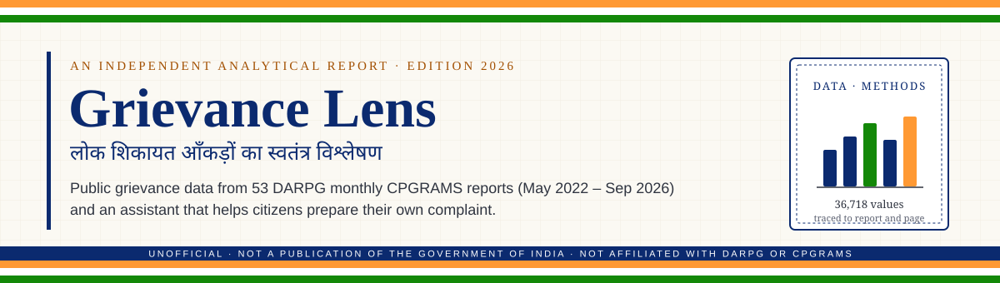
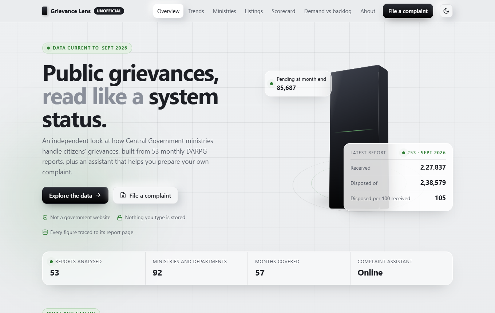
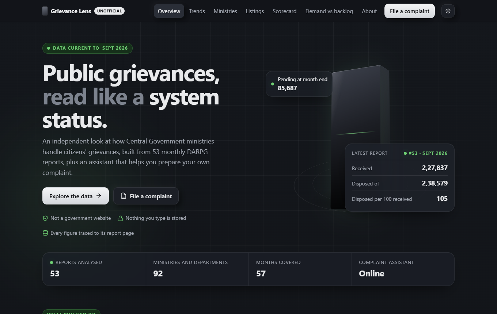
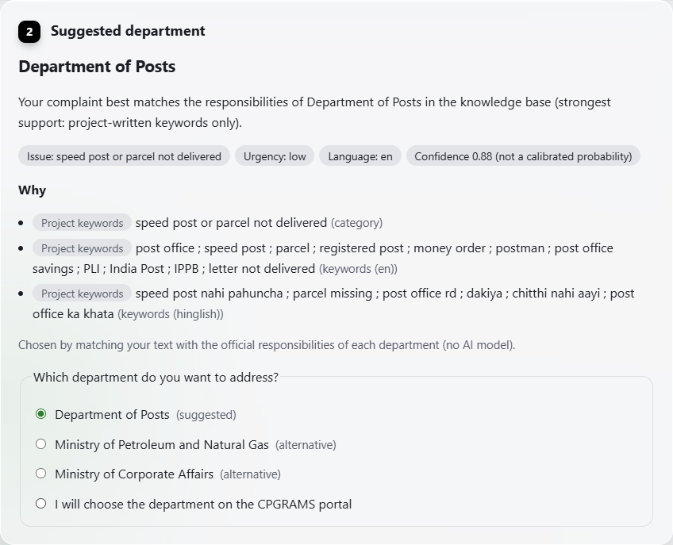
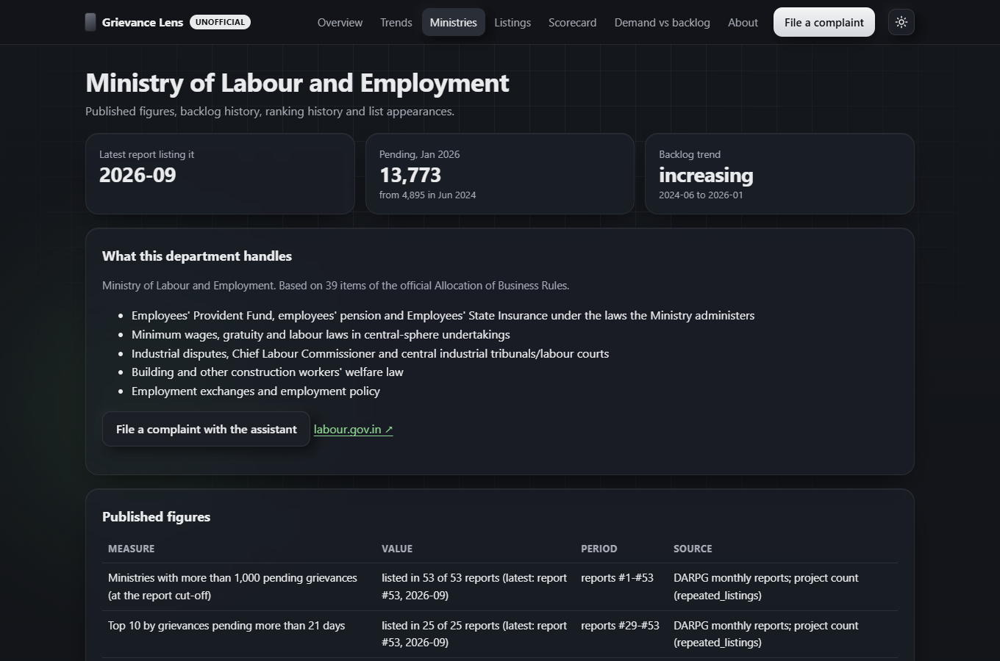
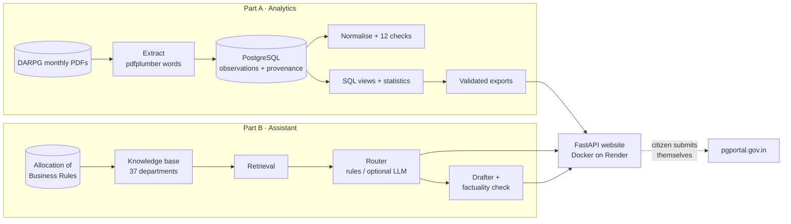

<div align="center">



<br>

[](https://github.com/harshgupta257/Grievance-Lens/actions/workflows/ci.yml)
[](https://grievance-lens.onrender.com)


**[Visit the live site](https://grievance-lens.onrender.com)** · **[Read the summary report](docs/report.md)** · **[Decision log](DESIGN.md)**

</div>

---

### Document particulars · दस्तावेज़ विवरण

| | |
|---|---|
| **Title** | Grievance Lens: An Independent Analysis of CPGRAMS Public Grievance Data, with a Citizen Complaint Assistant |
| **Nature of document** | Project report and technical documentation for an open-source portfolio project |
| **Reference period** | May 2022 – September 2026 (DARPG monthly reports #1 – #53) |
| **Primary sources** | DARPG *CPGRAMS Monthly Reports* (Central Ministries/Departments); Cabinet Secretariat *Allocation of Business Rules, 1961* |
| **Prepared by** | Harsh Gupta |
| **Status** | Live at [grievance-lens.onrender.com](https://grievance-lens.onrender.com) · **Unofficial** |

> [!IMPORTANT]
> **This is not a Government of India website or publication.** Grievance Lens is an independent portfolio
> project. It is not affiliated with or endorsed by the Department of Administrative Reforms and Public
> Grievances (DARPG), CPGRAMS or any ministry. It **never submits complaints**. Citizens file their own
> complaint on the official portal, [pgportal.gov.in](https://pgportal.gov.in/).

---

### Contents · विषय-सूची

| S. No. | Section | खंड |
|:---:|---|---|
| 1 | [Executive Summary](#1-executive-summary--कार्यकारी-सारांश) | कार्यकारी सारांश |
| 2 | [Background and Problem](#2-background-and-problem--पृष्ठभूमि-एवं-समस्या) | पृष्ठभूमि एवं समस्या |
| 3 | [Scope and Data Sources](#3-scope-and-data-sources--कार्यक्षेत्र-एवं-आँकड़ा-स्रोत) | कार्यक्षेत्र एवं आँकड़ा स्रोत |
| 4 | [Key Findings](#4-key-findings--प्रमुख-निष्कर्ष) | प्रमुख निष्कर्ष |
| 5 | [Methodology](#5-methodology--कार्यप्रणाली) | कार्यप्रणाली |
| 6 | [The Complaint Assistant](#6-the-complaint-assistant--शिकायत-सहायक) | शिकायत सहायक |
| 7 | [Evaluation](#7-evaluation--मूल्यांकन) | मूल्यांकन |
| 8 | [The Website](#8-the-website--वेबसाइट) | वेबसाइट |
| 9 | [System Architecture](#9-system-architecture--प्रणाली-संरचना) | प्रणाली संरचना |
| 10 | [Privacy and Safeguards](#10-privacy-and-safeguards--गोपनीयता-एवं-सुरक्षा-उपाय) | गोपनीयता एवं सुरक्षा उपाय |
| 11 | [Limitations](#11-limitations--सीमाएँ) | सीमाएँ |
| 12 | [Future Work](#12-future-work--आगे-का-कार्य) | आगे का कार्य |
| — | [Annexures I – IV](#annexures--अनुलग्नक) | अनुलग्नक |

---

## 1. Executive Summary · कार्यकारी सारांश

**1.1** The Centralised Public Grievance Redress and Monitoring System (CPGRAMS) receives about **2 lakh
grievances a month** for Central Ministries and Departments alone: an average of 1,98,270 a month in 2026,
and 2,27,837 in September 2026. DARPG publishes a monthly PDF report on how these grievances are handled.

**1.2** This project does two things:

| Part | Purpose | Output |
|:---:|---|---|
| **A** | Turn 53 monthly PDF reports into a verified, comparable dataset, and analyse it with sound statistics | 36,718 values, each traced to its report, page and table; trend tests; a ministry scorecard; a public website |
| **B** | Help a citizen find the Central department responsible for their grievance, and prepare a clear draft | A routing and drafting assistant for English, Hindi and Hinglish that **never submits anything** |

**1.3** Headline results:

> [!NOTE]
> - Grievances received have risen by about **1.4% a month** since April 2023 (Mann–Kendall test, q = 0.004),
>   and disposals have kept pace: about **100 disposed of for every 100 received** in 2026.
> - National month-end pending shows **no significant trend**. Behind that, **37 of 66** classified ministries
>   saw both rising demand and a rising backlog.
> - The assistant names the right department first in **65.3%** of 300 synthetic test complaints, and within
>   its top three in **89.1%**. That is why it always shows alternatives.

---

## 2. Background and Problem · पृष्ठभूमि एवं समस्या

**2.1 The data problem.** The monthly figures are locked in PDFs. Their layouts, thresholds and ranking methods
changed many times between 2022 and 2026, so they cannot be compared by simply copying numbers across
reports.

**2.2 The citizen's problem.** A citizen with a grievance often does not know which of dozens of Central
departments is responsible. A mis-filed complaint costs time.

**2.3 Why it matters.** A verified, comparable dataset shows where backlogs really build up, and where a
backlog only looks larger because more grievances arrived. An assistant grounded in the official mandates
of departments, which says "I am not sure" when it should, can save a mis-filed complaint.

---

## 3. Scope and Data Sources · कार्यक्षेत्र एवं आँकड़ा स्रोत

| S. No. | Source | Used for | Terms and provenance |
|:---:|---|---|---|
| 1 | [DARPG](https://www.darpg.gov.in/) *CPGRAMS Monthly Report, Central Ministries/Departments*, #1 – #53 | Part A data | Reproduction permitted with accurate representation and acknowledgement. URLs and SHA-256 checksums in [data/manifest.csv](data/manifest.csv) |
| 2 | [Cabinet Secretariat](https://cabsec.gov.in/allocationbusinessrules/completeaobrules/) *Government of India (Allocation of Business) Rules, 1961*, as amended to Series 386 (22 Jul 2026) | Official mandates of departments | [data/reference/mandates/sources.csv](data/reference/mandates/sources.csv) |
| 3 | Official department websites | Links only | Checks in `data/reference/mandates/url_checks.csv` |
| 4 | Synthetic complaints, labelled `source = synthetic` | Tuning and evaluating the assistant | Written for this project; **no real complaints or personal data** ([docs/complaint_data.md](docs/complaint_data.md)) |

**Out of scope:** grievances handled by State Governments and Union Territories, and how any individual
complaint will be handled.

---

## 4. Key Findings · प्रमुख निष्कर्ष

| S. No. | Finding | Evidence |
|:---:|---|---|
| 4.1 | **Demand roughly doubled:** 1,09,209 received in Apr 2023 → 2,27,837 in Sep 2026, about **+2,232 a month** | Mann–Kendall with Sen's slope, q = 0.004 |
| 4.2 | **Disposals kept pace:** 100 disposed of per 100 received in 2026 | Average of 9 complete months |
| 4.3 | **No national backlog trend:** aggregate month-end pending shows no significant trend | Same test family, FDR-controlled |
| 4.4 | **Ministry-level change:** backlogs rose significantly in **16** ministries, fell in **11**, and showed no significant trend in **63** | Monthly ministry panel, Benjamini–Hochberg FDR |
| 4.5 | **Persistent listing:** five bodies had more than 1,000 grievances pending in **all 53** reports | Published threshold lists, compared within one threshold |
| 4.6 | **Pressure beyond demand:** **37 of 66** classified ministries had both rising demand and a rising backlog | Demand vs backlog quadrants, ±1% a month band |

> [!TIP]
> Every figure on the [live site](https://grievance-lens.onrender.com) names the report and page it came from.
> Twelve randomly sampled values were checked against the PDF pages, and all **12 of 12 matched**.

---

## 5. Methodology · कार्यप्रणाली

**5.1 Acquisition and extraction.**
- Reports are downloaded politely with caching and checked by SHA-256.
- Values are extracted from word coordinates with pdfplumber: **387 tables, 36,718 observations**, each tagged
  with report, page and table.
- Extraction problems are stored, never dropped.
- Manual corrections need a reason and a reviewer.

**5.2 Normalisation and quality.**
- 121 printed names are resolved to **92 canonical ministries and departments**, with reviewed alias decisions.
- **12 data-quality checks** run on PostgreSQL, with checksummed migrations.

**5.3 Comparability rules.**
- Each month's value comes from the latest report that prints it.
- Trend tests use the core window, Apr 2023 – Sep 2026.
- Lists are compared only within one threshold, and ranks only within one method era and group.
- Absence from a list is **never treated as zero**.

**5.4 Statistics.**
- **Trends:** the Mann–Kendall test with the Hamed–Rao autocorrelation correction; effect size as Sen's slope;
  Benjamini–Hochberg false-discovery control for each family of tests.
- **Rank stability:** Spearman correlation between consecutive comparable reports.
- **Scorecard:** a project construct, *not an official rating*. It uses percentiles within each group, no
  zero-filling, and ranks shown with 90% intervals from 1,000 random weightings.

Details: [docs/methodology.md](docs/methodology.md) · [docs/scorecard.md](docs/scorecard.md) ·
[docs/data_quality.md](docs/data_quality.md) · [docs/report.md](docs/report.md)

---

## 6. The Complaint Assistant · शिकायत सहायक

| Step | What happens |
|:---:|---|
| 1. **Validate** | Unicode clean-up and length checks. Detects English, Hindi, Hinglish or mixed text. Flags embedded instructions, which are never followed |
| 2. **Retrieve** | Finds the top 5 candidate departments in a knowledge base of **37 departments**, built from **1,912 items** of the official Allocation of Business Rules plus clearly labelled project keywords |
| 3. **Decide** | Three thresholds tuned on development data choose between routing and **abstaining**: too vague, weak evidence, ambiguous, or likely a State matter. The assistant then asks a clarifying question |
| 4. **Explain** | Shows the suggested department, alternatives, evidence with citations, urgency, missing information, and a confidence explicitly marked **not calibrated** |
| 5. **Draft** | A fixed template keeps the complaint word for word, adds only the details given, and leaves placeholders for gaps. A factuality check reviews every draft |

**Optional AI selection.** Claude (Anthropic) or Gemini (Google) can choose among the retrieved candidates:
- The output is constrained to a list of the candidate keys.
- Personal identifiers are redacted before sending.
- Errors fall back to the offline decision.

On the public site the AI step is **off**. The live site will not start with Gemini's free tier, because
Google may use free-tier prompts to improve its products.

Details: [docs/mandate_knowledge_base.md](docs/mandate_knowledge_base.md) · [docs/routing.md](docs/routing.md) ·
[docs/drafting.md](docs/drafting.md)

---

## 7. Evaluation · मूल्यांकन

**7.1** The evaluation uses 300 synthetic complaints. **These are not results on real complaints.**

> [!WARNING]
> The reference labels were assigned by an AI assistant at the owner's request and are **not independent**.
> The same assistant also wrote the complaints and the keywords, and its labels agree with its own writing
> intent on 283 of 300. The results are therefore likely optimistic.

| S. No. | System | Top-1 (95% CI) | Top-3 | Macro-F1 | Non-routable items correctly abstained |
|:---:|---|---|---|---|---|
| 1 | Retrieval + rules, lexical (**deployed**) | **65.3%** (59.2–71.0) | **89.1%** | 0.69 | 28 / 52 |
| 2 | Retrieval + rules, hybrid embeddings | 70.2% (64.2–75.5) | 90.7% | 0.74 | 32 / 52 |
| 3 | TF-IDF + logistic regression baseline | 9.7% (6.6–14.0) | 69.8% | 0.16 | 51 / 52 (it abstains on 90%) |
| 4 | Retrieval + LLM | *not run: no paid API key* | | | |

**7.2 Drafter.**
- Across 50 drafts there were **0 unsupported facts** and 0 unsupported claim words.
- The addressee was correct in 31 of 50, because routing errors carry over.
- Rubric scores: clarity 3.8, faithfulness 5.0, completeness 2.0 (many placeholders are left for the user).

**7.3 Prompt injection.** 9 of 10 attempts were flagged, and none changed the output.

Details: [docs/evaluation.md](docs/evaluation.md) · [docs/evaluation_results.md](docs/evaluation_results.md)

---

## 8. The Website · वेबसाइट

**[grievance-lens.onrender.com](https://grievance-lens.onrender.com)** has light and dark themes and works on
phones.

| S. No. | Page | Contents |
|:---:|---|---|
| 1 | [Overview](https://grievance-lens.onrender.com/) | Live status of the latest report, the monthly received-vs-disposed chart, and three findings with sources |
| 2 | [Trends](https://grievance-lens.onrender.com/trends) | National receipts, disposals and pending, with trend tests |
| 3 | [Ministries](https://grievance-lens.onrender.com/ministries) | All 92 bodies, searchable, each with its own page of figures, backlog and ranking history |
| 4 | [Listings](https://grievance-lens.onrender.com/lists) · [Scorecard](https://grievance-lens.onrender.com/scorecard) · [Demand vs backlog](https://grievance-lens.onrender.com/demand) | Repeated list appearances, the within-group scorecard with rank intervals, and demand/backlog quadrants |
| 5 | [File a complaint](https://grievance-lens.onrender.com/assistant) | The assistant: suggested department, evidence, and a draft to copy |
| 6 | [About](https://grievance-lens.onrender.com/about) · [Privacy](https://grievance-lens.onrender.com/privacy) · [Terms](https://grievance-lens.onrender.com/terms) | Methods, limits, contact and policies |

<table>
  <tr>
    <td width="50%"><br><sub><b>Fig. 1</b> Overview page, light theme</sub></td>
    <td width="50%"><br><sub><b>Fig. 2</b> Overview page, dark theme</sub></td>
  </tr>
  <tr>
    <td width="50%"><br><sub><b>Fig. 3</b> Suggested department, with evidence and alternatives</sub></td>
    <td width="50%"><br><sub><b>Fig. 4</b> A ministry's figures and backlog history</sub></td>
  </tr>
</table>

---

## 9. System Architecture · प्रणाली संरचना



| Layer | Technology |
|---|---|
| Language and data | Python 3.11 · pandas · NumPy · SciPy · pymannkendall · RapidFuzz |
| Storage | PostgreSQL 16 · SQLAlchemy · checksummed SQL migrations (analytics pipeline only; the website needs no database) |
| Extraction | pdfplumber |
| Retrieval and models | scikit-learn (TF-IDF); optional multilingual-e5 embeddings; optional Claude or Gemini |
| Web | FastAPI · uvicorn · plain HTML, CSS and JavaScript (no frameworks or third-party scripts) |
| Delivery | Docker · GitHub Actions CI · Render (with Cloudflare in front) |
| Quality | pytest · ruff · Pydantic validation |

Every design decision, with the alternatives rejected, is recorded in **[DESIGN.md](DESIGN.md)** (D-001 to D-053).

---

## 10. Privacy and Safeguards · गोपनीयता एवं सुरक्षा उपाय

| S. No. | Safeguard |
|:---:|---|
| 1 | **Nothing is stored.** The site keeps no complaint text and has no accounts, cookies, analytics or third-party scripts |
| 2 | **Logs never contain what you type.** They record only the method, path, status and time |
| 3 | **Never submits.** The citizen copies the draft and files it on the official portal |
| 4 | **Personal identifiers are redacted** (phone, Aadhaar-like numbers, PAN, e-mail, bank and card numbers, IFSC) before any text could reach an AI provider. Paid API plans only |
| 5 | **Strict browser security:** same-origin Content Security Policy, HSTS, `nosniff`, `no-referrer` |
| 6 | **Per-visitor rate limiting**, with the visitor's address taken from Cloudflare's `CF-Connecting-IP`, which visitors cannot forge (measured on the live host, [D-053](DESIGN.md)) |
| 7 | **Secrets stay out of git.** Keys live only in `.env` or the host's dashboard; `.env.example` holds placeholders |

Full statement: [Privacy policy](https://grievance-lens.onrender.com/privacy).

---

## 11. Limitations · सीमाएँ

| S. No. | Limitation |
|:---:|---|
| 1 | **Verification was not independent.** The 12-of-12 value check and the knowledge-base review were done by an AI assistant at the owner's request, not by an independent person |
| 2 | **Evaluation is synthetic and not independent** (see 7.1), so the results are likely optimistic |
| 3 | **Observational data:** no causal claims. Published lists are censored at their thresholds, and the monthly ministry panel covers 20 months |
| 4 | **Coverage:** the assistant's knowledge base covers 37 of 92 CPGRAMS entities ([docs/kb_review.md](docs/kb_review.md)) |
| 5 | **Abstention is weak on vague complaints** (2 of 12) |
| 6 | **The LLM path is unit-tested but has not been run live**, so no LLM results are claimed |
| 7 | **Hosting:** the site runs as a single instance with in-memory rate limiting. The free plan sleeps when idle, so the first visit after a pause is slow |

The complete list is in [DESIGN.md: Known limitations](DESIGN.md#known-limitations).

---

## 12. Future Work · आगे का कार्य

1. Independent labelling of the evaluation set, then a live LLM run with a cost report.
2. Evaluation on real complaints, only with permission and privacy safeguards.
3. Better abstention for vague text: a "none of these" signal and a calibration study.
4. A knowledge-base review by someone experienced with CPGRAMS, adding the pension department and State-routing guidance.
5. A States/UTs series for a Centre-versus-State comparison.

---

## Annexures · अनुलग्नक

<details>
<summary><b>Annexure I: Running the website locally (Windows PowerShell)</b></summary>

<br>

```powershell
py -3.11 -m venv .venv
.\.venv\Scripts\Activate.ps1          # if blocked: Set-ExecutionPolicy -Scope CurrentUser RemoteSigned
python -m pip install -r requirements-dev.txt
Copy-Item .env.example .env           # optional settings; no API key is needed
uvicorn src.app.main:app --host 127.0.0.1 --port 8000      # open http://127.0.0.1:8000/
```

**With Docker:** `docker build -t grievance-lens .` then `docker run -p 8000:8000 grievance-lens`.
**Deploying:** the Render blueprint in `render.yaml`; see [docs/deploy.md](docs/deploy.md).
**Optional AI provider (local testing):** set `LLM_PROVIDER=gemini` and `GEMINI_API_KEY` in `.env`.
See [docs/routing.md](docs/routing.md).

</details>

<details>
<summary><b>Annexure II: Rebuilding the dataset from the PDFs</b></summary>

<br>

You need PostgreSQL 16 (`docker compose up -d`) and `POSTGRES_PASSWORD` in `.env`.

```powershell
python -m src.check_db --migrate         # create or upgrade the schema
python -m src.discover.download          # fetch missing PDFs (polite, cached, SHA-256 verified); ~140 MB
python -m src.extract.run                # parse all reports -> data/interim/extracted/*.json (~9 min)
python -m src.extract.load               # load staging JSON into PostgreSQL (safe to re-run)
python -m src.normalise.build            # printed names -> canonical ministries
python -m src.normalise.load             # load ministries, aliases and relationships; link observations
python -m src.validate.checks            # 12 data-quality checks -> docs/data_quality_checks.md
python -m src.validate.sample            # 12 random values to verify by eye -> docs/manual_verification.csv
python -m src.analysis.run               # SQL views + analyses + scorecard -> data/processed/analysis
python -m src.export.powerbi             # validated tables -> data/processed/powerbi (also used by the website)
python -m src.knowledge.aob --download   # official Allocation of Business Rules PDF (SHA-256 checked)
python -m src.knowledge.aob              # parse its Second Schedule -> data/reference/mandates/aob_items.csv
python -m src.knowledge.build            # validate and resolve the knowledge base -> data/processed/knowledge
python -m src.complaints.corpus          # synthetic complaint sets -> data/complaints/
python -m src.routing.tune               # thresholds from development data only -> src/routing/thresholds.json
python -m src.evaluation.run             # router, baseline and drafter evaluation -> docs/evaluation_results.md
```

</details>

<details>
<summary><b>Annexure III: Testing</b></summary>

<br>

```powershell
python -m pytest                      # 205 unit and API tests; no database or API key needed
$env:TEST_DATABASE_URL = "postgresql+psycopg2://cpgrams:<password>@127.0.0.1:5432/cpgrams"
python -m pytest -m "pdf or not pdf"  # adds the database integration and PDF golden-value tests
ruff check . ; ruff format --check .
```

External APIs are mocked, and no test needs credentials. CI runs lint and the tests on every push, then builds
and smoke-tests the Docker image.

</details>

<details>
<summary><b>Annexure IV: Repository structure</b></summary>

<br>

```
├── DESIGN.md                    decision log (D-001 to D-053), architecture, limitations
├── Dockerfile, render.yaml      production image and Render blueprint
├── data/
│   ├── manifest.csv             every source PDF: URL, checksum
│   ├── reference/               ministry master, aliases; mandates (AoB items, departments, sources, URL checks)
│   ├── complaints/              synthetic development set, evaluation texts, labels
│   ├── processed/               analysis, exports (used by the website), knowledge base, evaluation
│   └── raw/, interim/           PDFs, staging, caches (git-ignored)
├── docs/                        methodology, scorecard, knowledge base, routing, drafting, evaluation, app, deploy, report
├── sql/                         migrations and analysis views
├── src/
│   ├── discover/ extract/ normalise/ validate/ analysis/ export/    Part A pipeline
│   ├── knowledge/ complaints/ routing/ drafting/ performance/      Part B assistant
│   ├── evaluation/              evaluation script
│   └── app/                     FastAPI app, page generator (pages.py), static site
└── tests/                       unit, API, opt-in database and PDF tests
```

</details>

---

<div align="center">

<sub><b>Disclaimer · अस्वीकरण</b></sub><br>
<sub>This is an independent portfolio project. It is not affiliated with or endorsed by DARPG, CPGRAMS or the
Government of India. The assistant is informational only: it never submits complaints, does not guarantee
correct routing or resolution, and does not provide legal advice. Figures are derived from public DARPG
reports and may contain extraction errors; check the cited report before relying on any figure.</sub>

<br><br>

<sub>— End of document · दस्तावेज़ समाप्त —</sub>

</div>
