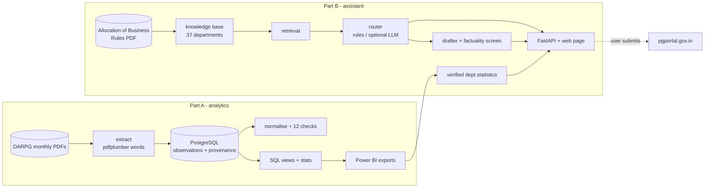
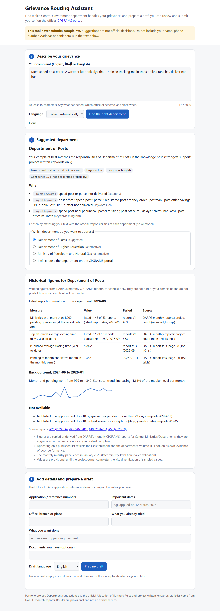
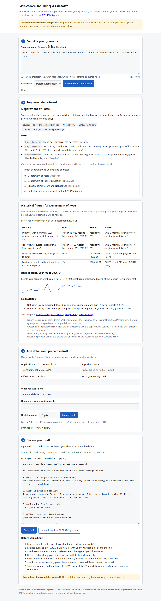
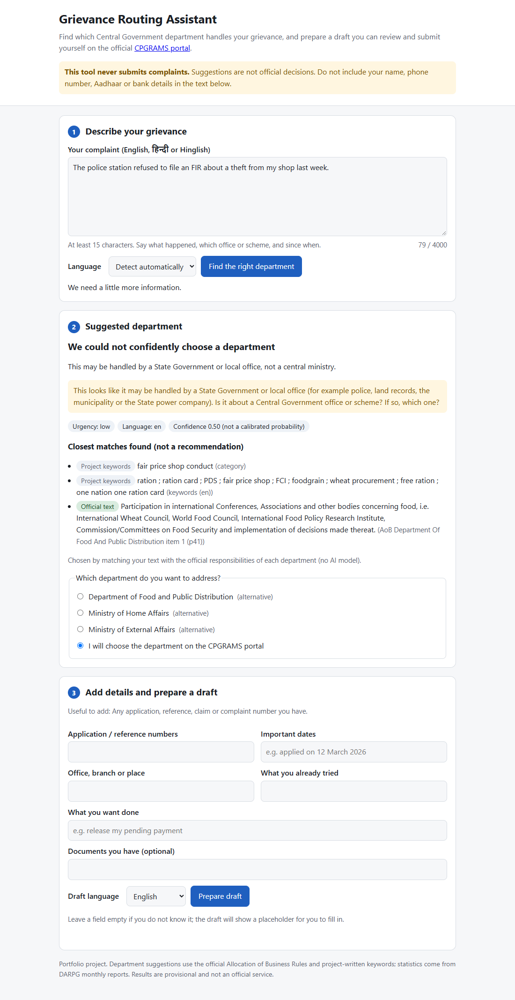
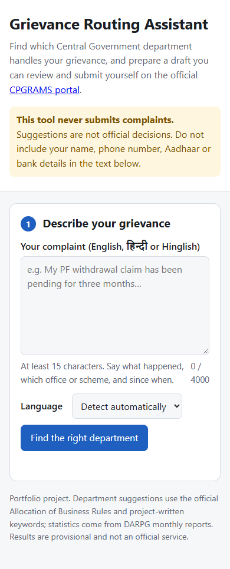

# CPGRAMS Grievance Intelligence Platform

> **Status: all 13 phases built (portfolio project).** The 12 sampled report values were checked against the
> PDFs (12 of 12 match), and the 300 evaluation complaints were labelled. Both were done by the AI assistant at the
> owner's request, so neither is an independent human check. Part A was rebuilt from the PDFs into a fresh
> database with identical outputs. The LLM routing path is built and unit-tested but has not been run against the
> live API. No Power BI report or deployment exists. See [Limitations](#limitations).

Data analytics on India's public grievance reports, plus an assistant that helps citizens work out which Central
Government department handles their grievance and prepares a draft complaint they review and **submit
themselves**.

## Problem and why it matters

**The problem.** India's Centralised Public Grievance Redress and Monitoring System (CPGRAMS) receives about
200,000 grievances a month for Central Ministries and Departments alone (2026 average 198,270; Sep 2026:
227,837). DARPG publishes
monthly PDF reports on how they are handled, but:
- the figures are locked in PDFs whose layouts, thresholds and ranking methods changed many times between
  2022 and 2026;
- citizens often don't know which of dozens of departments is responsible for their problem.

**Why it matters.** Turning the reports into a verified, comparable dataset shows where backlog builds up,
and where it only looks that way because demand rose. Helping citizens find the right department, with
evidence from official mandates and an honest "I'm not sure" when it applies, can save a mis-filed complaint.

## Features

| Part A: grievance analytics | Part B: routing and drafting assistant |
|---|---|
| Checksum-verified acquisition of 53 monthly reports (May 2022 – Sep 2026) | Knowledge base of 37 departments built on the official **Allocation of Business Rules** (1,912 parsed items) |
| Word-coordinate PDF extraction: 387 tables, **36,718 provenance-tagged observations** (report, page, table) | English, Hindi (Devanagari) and Hinglish input |
| 121 printed names resolved to 92 canonical ministries, with reviewed alias decisions | Retrieval of candidate departments with labelled evidence (official text vs project keywords) |
| 12 data-quality checks; PostgreSQL with checksummed migrations | Tuned abstention: asks a clarifying question, flags likely State matters |
| SQL views + statistics: Mann–Kendall (Hamed–Rao), Sen's slope, Benjamini–Hochberg FDR, rank stability | Optional LLM selection (Claude) with schema-constrained output, PII redaction, caching and cost logging |
| Within-group ministry scorecard with 1,000-draw weight sensitivity | Template drafter that never invents facts, with a factuality screen |
| Power BI star schema (15 validated tables) and a five-page dashboard guide | Verified department statistics with sources; FastAPI and an accessible web page; **never submits complaints** |

## Architecture



Every design decision, with the alternatives rejected, is in **[DESIGN.md](DESIGN.md)** (D-001 to D-047).

## Technology stack

- **Language:** Python 3.11.
- **Database:** PostgreSQL 16 (Docker Compose), SQLAlchemy, checksummed SQL migrations.
- **Extraction:** pdfplumber.
- **Analysis:** pandas, NumPy, SciPy, pymannkendall, RapidFuzz.
- **Retrieval and models:** scikit-learn (TF-IDF, logistic regression); sentence-transformers with
  `intfloat/multilingual-e5-small` (optional).
- **LLM:** the Anthropic SDK (optional; default model `claude-opus-5-5`).
- **Validation:** Pydantic.
- **App:** FastAPI with uvicorn; vanilla HTML, CSS and JavaScript.
- **Quality:** pytest, ruff.

## Data sources

| Source | Use | Terms |
|---|---|---|
| [DARPG](https://www.darpg.gov.in/) *CPGRAMS Monthly Report, Central Ministries/Departments*, #1–#53 | Part A data | DARPG's copyright policy permits reproduction with accurate representation and acknowledgement. URLs and SHA-256 are in [data/manifest.csv](data/manifest.csv) |
| [Cabinet Secretariat](https://cabsec.gov.in/allocationbusinessrules/completeaobrules/) *The Government of India (Allocation of Business) Rules, 1961*, as amended to Series 386 (22 Jul 2026) | Official department mandates | Recorded in [data/reference/mandates/sources.csv](data/reference/mandates/sources.csv) |
| Department websites | Official URLs only | Checks recorded in `data/reference/mandates/url_checks.csv` |
| Synthetic complaints (`source = synthetic`) | Training, tuning and evaluation | Written for this project; no real complaints or personal data ([docs/complaint_data.md](docs/complaint_data.md)) |

## Installation and configuration (Windows PowerShell)

Prerequisites: Python 3.11, Git, and either **Docker Desktop** (recommended) or a local PostgreSQL 16 server.

```powershell
py -3.11 -m venv .venv
.\.venv\Scripts\Activate.ps1          # if blocked: Set-ExecutionPolicy -Scope CurrentUser RemoteSigned
python -m pip install -r requirements-dev.txt
# optional, only for dense/hybrid retrieval (about 1 GB with the model):
#   python -m pip install torch==2.14.1 --index-url https://download.pytorch.org/whl/cpu
#   python -m pip install -r requirements-embeddings.txt
Copy-Item .env.example .env           # then set POSTGRES_PASSWORD; LLM settings are optional
```

`.env.example` documents every setting:
- **Database:** `POSTGRES_*` or `DATABASE_URL`.
- **Optional router and LLM settings:** `LLM_PROVIDER`, `LLM_MODEL`, `LLM_EFFORT`, timeouts, retries, the
  call cap, prices and `ROUTER_RETRIEVAL`.
- **Rules:** secrets live only in `.env` (git-ignored). Analytics, the offline router, the app and the
  test suite need **no API key**. Settings are validated at startup.

## Database setup

```powershell
docker compose up -d ; docker compose ps          # wait for "healthy"
python -m src.check_db --migrate
```

Expected output on a fresh database:

```
Connected: PostgreSQL 16.4
Applied migration 0001_initial_schema.sql
Applied migration 0002_grai_dimension_metrics.sql
Applied migration 0003_ministry_resolution.sql
Schema is up to date.
```

| Task | Command |
|---|---|
| Check status | `python -m src.check_db` (exit code 0 = up to date, 1 = error, 2 = migrations pending) |
| **Reset (deletes all data)** | `docker compose down -v`, `docker compose up -d`, `python -m src.check_db --migrate` |

## Data-processing workflow

```powershell
python -m src.discover.download          # fetch missing PDFs (polite, cached, SHA-256 verified); ~140 MB
python -m src.extract.run                # parse all reports -> data/interim/extracted/*.json (~9 min)
python -m src.extract.load               # load staging JSON into PostgreSQL (safe to re-run)
python -m src.normalise.build            # printed names -> canonical ministries
python -m src.normalise.load             # load ministries/aliases/relationships, link observations
python -m src.validate.checks            # 12 data-quality checks -> docs/data_quality_checks.md
python -m src.validate.sample            # 12 random values to verify by eye -> docs/manual_verification.csv
python -m src.analysis.run               # SQL views + analyses A-G + scorecard -> data/processed/analysis
python -m src.export.powerbi             # validated Power BI tables -> data/processed/powerbi
python -m src.knowledge.aob --download   # official Allocation of Business Rules PDF (SHA-256 checked)
python -m src.knowledge.aob              # parse its Second Schedule -> data/reference/mandates/aob_items.csv
python -m src.knowledge.build            # validate + resolve the knowledge base -> data/processed/knowledge
python -m src.complaints.corpus          # synthetic complaint sets -> data/complaints/
python -m src.routing.tune               # thresholds from development data only -> src/routing/thresholds.json
python -m src.evaluation.run             # router, baseline and drafter evaluation -> docs/evaluation_results.md
```

Extraction problems are stored, never dropped. Manual corrections need a reason and a reviewer
(`data/overrides/overrides.csv`). Ministry alias decisions are reviewed by a person.

## Analytics methodology

- **Comparability first.**
  - Trend tests use the core window, Apr 2023 – Sep 2026 (month-end cut-offs).
  - Each month's value comes from the latest report that prints it.
  - Lists are compared only within one threshold, and ranks only within one layout era and group.
  - Absence from a list is never treated as zero.
- **Statistics.**
  - Trends: Mann–Kendall with the Hamed–Rao correction (pre-whitening fallback), effect size as Sen's
    slope, and Benjamini–Hochberg FDR per test family.
  - Rank stability: Spearman correlation between consecutive comparable reports.
  - Demand vs backlog: quadrants with sensitivity to the band.
- **Scorecard.** A project construct, not an official rating: within-group percentiles, no zero-filling,
  ranks with 90% intervals from 1,000 random weightings.

Details: [docs/methodology.md](docs/methodology.md), [docs/scorecard.md](docs/scorecard.md),
[docs/data_quality.md](docs/data_quality.md). Summary report: **[docs/report.md](docs/report.md)**.

**Key verified findings** (12 sampled values checked against the PDFs: 12 of 12 match):
- **Demand:** monthly receipts roughly doubled (109,209 in Apr 2023 → 227,837 in Sep 2026; +2,232 a month,
  q = 0.004), and disposals kept pace.
- **Backlog:** aggregate month-end pending shows no significant trend.
- **Persistent listing:** five bodies were listed with more than 1,000 pending in all 53 reports.
- **Ministry-level change:** in the monthly panel, 16 ministries' backlogs rose significantly, 11 fell
  and 63 showed no significant trend.

## AI routing methodology

1. **Validate** (Unicode, length) and treat the text as data. **Detect** English, Hindi, Hinglish or mixed.
   **Flag** embedded instructions; they are never followed.
2. **Retrieve** the top 5 departments from the knowledge base:
   - official AoB items plus labelled, project-written keywords;
   - lexical TF-IDF on character and word n-grams (chosen on development data); hybrid with
     multilingual-e5 embeddings optional;
   - no vector database (1,287 chunks).
3. **Select:**
   - *offline*: three thresholds tuned on development data decide between routing and abstaining
     (insufficient information, low evidence, ambiguous, State matter);
   - *LLM (optional)*: Claude chooses among the candidates via structured output whose department field
     is an **enum of the candidate keys**. The output is re-validated, and the complaint is redacted and
     placed in a nonce-delimited data block. Refusals and errors fall back to the offline decision,
     labelled as such.
4. **Respond:** a Pydantic `RouteResult` with alternatives, evidence and citations, urgency, missing
   information, a clarifying question, and a confidence explicitly marked **not calibrated**.
5. **Draft:** a deterministic template. The complaint is kept verbatim, details are added as given, gaps
   become placeholders, and a factuality screen checks every draft. Verified statistics are shown beside
   the draft, never in it.

Details: [docs/mandate_knowledge_base.md](docs/mandate_knowledge_base.md), [docs/routing.md](docs/routing.md),
[docs/drafting.md](docs/drafting.md).

## Evaluation results

300 synthetic complaints. Reference labels for all 300 complaints were assigned by the AI assistant (Claude) at the owner's request and are **not independent** (the same assistant wrote the complaints; its labels agree with its own writing intent on 283 of 300). **These are not results on real complaints**
([docs/evaluation.md](docs/evaluation.md), [docs/evaluation_results.md](docs/evaluation_results.md)).

| System | Top-1 (95% CI) | Top-3 | Macro-F1 | Non-routable correctly abstained |
|---|---|---|---|---|
| Retrieval + rules, lexical (default) | 65.3% (59.2–71.0) | 89.1% | 0.69 | 28 / 52 |
| Retrieval + rules, hybrid | 70.2% (64.2–75.5) | 90.7% | 0.74 | 32 / 52 |
| TF-IDF + logistic regression baseline | 9.7% (6.6–14.0) | 69.8% | 0.16 | 51 / 52 (it abstains on 90%) |
| Retrieval + LLM | not run: no API key in the build environment | | | |

- **Drafter:** 50 drafts, all complete and verbatim, with 0 unsupported factual tokens and 0 unsupported
  claim words. The addressee was correct in 31 of 50, because routing errors carry over. Rubric scores (assistant, 1–5): clarity 3.8, faithfulness 5.0, completeness 2.0 (many placeholders left for the user).
- **Prompt injection:** 9 of 10 attempts flagged, and none changed the output.

## Running the app

```powershell
uvicorn src.app.main:app --host 127.0.0.1 --port 8000      # open http://127.0.0.1:8000/ (assistant: /assistant)
python -m src.app.demo --base http://127.0.0.1:8000        # scripted end-to-end demo -> docs/app_demo.md
```

The website has analytics pages (overview, trends, ministries, listings, scorecard, demand vs backlog, about)
and the complaint assistant at `/assistant`. Endpoints: `POST /route`, `POST /draft`,
`GET /ministry/{key}/performance`, `GET /health`, and read-only `GET /api/*` for the pages. See
[docs/app.md](docs/app.md).

**Deploying:** `docker build -t cpgrams-app .` then `docker run -p 8000:8000 cpgrams-app`, or the Render
blueprint in `render.yaml`. No database or API key is needed. See [docs/deploy.md](docs/deploy.md).

## Screenshots

Captured from the running app with headless Chrome on 22 Oct 2026.

| Suggested department with verified figures | Draft review |
|---|---|
|  |  |
| **Abstention (likely State matter)** | **Mobile** |
|  |  |

## Testing

```powershell
python -m pytest                      # 183 unit + API tests; DB integration tests skip without a database
$env:TEST_DATABASE_URL = "postgresql+psycopg2://cpgrams:<password>@127.0.0.1:5432/cpgrams"
python -m pytest -m "pdf or not pdf"  # all 220 tests, incl. DB integration and PDF golden values
ruff check . ; ruff format --check .
```

External APIs are mocked: the LLM path is tested with a fake client, and no test needs credentials.

## Project structure

```
├── DESIGN.md                    decision log (D-001 to D-047), architecture, limitations
├── data/
│   ├── manifest.csv             every source PDF: URL, checksum
│   ├── reference/               ministry master, aliases; mandates/ (AoB items, departments.json, sources, URL checks)
│   ├── complaints/              synthetic dev set, evaluation texts, owner labelling sheet, generation intent
│   ├── processed/               analysis/, powerbi/ (star schema), knowledge/ (resolved KB), evaluation/
│   └── raw/, interim/           PDFs, staging, caches (git-ignored)
├── docs/                        methodology, scorecard, Power BI guide, KB, routing, drafting, evaluation, app, report, portfolio
├── sql/migrations/, sql/views/  schema and analysis views
├── src/
│   ├── discover/, extract/, normalise/, validate/, analysis/, export/   Part A
│   ├── knowledge/               AoB parser, KB build, retrieval
│   ├── complaints/              synthetic corpus build
│   ├── routing/                 input handling, rules, LLM selector, router, baseline, tuning
│   ├── drafting/, performance/  drafter + factuality screen; verified department statistics
│   ├── evaluation/              evaluation script
│   └── app/                     FastAPI app, static page, demo
└── tests/                       unit, API, opt-in DB integration, PDF golden tests
```

## Limitations

- **Verification by the assistant, not a person:** 12 of 12 sampled values match the PDFs. Published
  lists are censored at their thresholds, the ministry panel covers 20 months, and the data are
  observational (no causal claims).
- **Non-independent evaluation:** Part B data are synthetic, and the same assistant wrote the keywords,
  the complaints and the labels, so the results are likely optimistic.
- **LLM path not run:** no LLM results are claimed.
- **Coverage:** the knowledge base covers 37 of 92 CPGRAMS entities (review notes:
  [docs/kb_review.md](docs/kb_review.md)).
- **Abstention:** weak on vague complaints (2 of 12).
- **Not executed here:** Docker (WSL2 is missing on the build machine; PostgreSQL 16.2 was used directly).
  No Power BI report, no deployment, no authentication, and in-memory rate limiting.

The full list is in [DESIGN.md — Known limitations](DESIGN.md#known-limitations).

## Future improvements

- Owner labels, then the final evaluation; a run of the LLM router with a cost report.
- Real-complaint evaluation, only with permission and privacy safeguards.
- Better abstention for vague text: a "none of these" signal and a calibration study.
- Knowledge-base review by someone who knows CPGRAMS, plus the pension department and State-routing
  guidance.
- A Power BI build, a Docker run, and a States/UTs series.

## Disclaimer

This is an independent portfolio project, not affiliated with DARPG or the Government of India. The assistant
is informational only. It never submits complaints, does not guarantee correct routing or resolution, and does
not provide legal advice.
