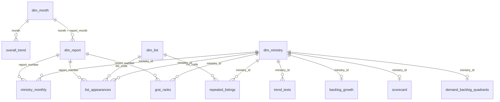

# Power BI dashboard guide (Phase 6)

> **Status: a design guide, not a built dashboard.** This project produces validated CSV exports and the
> instructions below. No `.pbix` file has been built or tested: Power BI Desktop was not available in the
> build environment. Any DAX written here is still to be checked in Power BI. Results are provisional until
> the project owner has visually checked the sampled values ([data_quality.md](data_quality.md) §6).

## 1. The exports

Reproduce them with this PowerShell command. Run it from the project root, with the venv active and the
database loaded and normalised:

```powershell
python -m src.export.powerbi
```

The command recreates the views, reruns analyses A–G and the scorecard, and checks every table. It writes to
`data/processed/powerbi/` only if every check passes:
- **Keys:** no blank keys, no duplicate keys, and every foreign key resolves to its dimension table.
- **Reconciliation with analysis B:** list appearances and listing runs match, ministry by ministry.

If any check fails, it lists the problems, writes nothing and exits with code 1.

| File | Grain | Rows* | Used on pages |
|---|---|---|---|
| `dim_month.csv` | calendar month, Jan 2022 – Sep 2026 | 57 | 1, 4 |
| `dim_report.csv` | English monthly report #1–#53 | 53 | 3, 4 |
| `dim_ministry.csv` | canonical ministry or department | 92 | 2–5 |
| `dim_list.csv` | published list type | 6 | 3 |
| `overall_trend.csv` | month (Central Secretariat aggregate) | 57 | 1 |
| `ministry_monthly.csv` | ministry × report, T6 panel #26–#45 | 1,800 | 4 |
| `list_appearances.csv` | ministry × list × report | 2,481 | 3 |
| `repeated_listings.csv` | ministry × list type | 181 | 3 |
| `backlog_growth.csv` | ministry (T6 panel) | 90 | 4 |
| `trend_tests.csv` | trend test | 99 | 1, 4 |
| `grai_ranks.csv` | ministry × GRI/GRAI ranking table | 4,490 | 2 |
| `scorecard.csv` | ministry ranked in GRAI #46–#53 | 91 | 2 |
| `scorecard_sensitivity.csv` | weight variant × group | 10 | 2 |
| `demand_backlog_quadrants.csv` | ministry (T6 panel) | 90 | 5 |
| `demand_backlog_sensitivity.csv` | stable band × demand trend × backlog trend | 27 | 5 |

\* At the time of writing. `export_manifest.csv` records the current row counts, the grain, the key and a
SHA-256 for each file. `data_dictionary.csv` describes every column.

**Which brief exports were renamed or left out, and why**
- The brief's `chronic_offenders.csv` is called `repeated_listings.csv`. Being on a published list
  reflects volume and thresholds, not wrongdoing (DESIGN.md D-035).
- Ministry-level flows after #45 are not exported, because they failed validation (D-017).
- Average closing time is exported only for the ministries in the published Top-10 lists. It is not a
  continuous ministry series, because no such series is published.
- Nothing in the exports is synthetic.

**Provenance.** Every row-level fact carries `report_number` and `pdf_page`, so a value can be traced to
the PDF. `overall_trend.source_report` names the report each monthly value was taken from: the latest
report that prints that month (D-026).

## 2. Loading and model

### Load
1. In Power BI Desktop, use **Get data → Text/CSV** for each file. Alternatively, use **Folder** on
   `data/processed/powerbi/` and keep one query per file.
2. Set **File origin** to `65001: Unicode (UTF-8)`.
3. Leave `data_dictionary.csv` and `export_manifest.csv` out of the model, or load them as reference
   tables without relationships.
4. Check the data types in Power Query:
   - `month`, `report_month`, `period_*`, `*_month` and `data_cutoff_date` are **Date**.
   - `True`/`False` columns are **True/False**.
   - IDs, counts and ranks are **Whole number**.
   - Slopes, shares, percentiles, p-values and q-values are **Decimal number**. Do not use Fixed decimal:
     it would round small p-values to zero.
5. Empty cells mean *not available* and must stay blank. Do not replace them with 0. The one exception is
   `demand_backlog_sensitivity.ministries`, where 0 is a true count.
6. Under **File → Options → Current file → Data load**, turn off **Autodetect new relationships**. Several
   tables share generic column names such as `group`, `months` and `n`.
7. Sort `dim_month[month_name]` by `month_number`, and `dim_month[month_label]` by `month`.

**Do not mark `dim_month` as a date table.** It holds one row per month (the 1st), not one row per day. The
measures below use `month_index` instead of time-intelligence functions, so they work at monthly grain.

### Relationships

Every relationship is **many-to-one (\*:1)**, filters in **one direction** (dimension → fact), and is
active. Ministry-grain tables like `scorecard` have one row per ministry, so Power BI may propose
*one-to-one*. Change it to many-to-one with single direction, so the dimension always filters the fact.



| From (many) | To (one) | Note |
|---|---|---|
| `overall_trend[month]` | `dim_month[month]` | |
| `dim_report[report_month]` | `dim_month[month]` | Lets a month slicer filter report-grain facts through `dim_report` |
| `ministry_monthly`, `list_appearances`, `grai_ranks` `[report_number]` | `dim_report[report_number]` | Report-grain facts have no direct link to `dim_month`. A second path would make the model ambiguous |
| `list_appearances`, `repeated_listings` `[list_code]` | `dim_list[list_code]` | |
| every fact `[ministry_id]` | `dim_ministry[ministry_id]` | `trend_tests[ministry_id]` is blank for aggregate series |
| `scorecard_sensitivity`, `demand_backlog_sensitivity` | none | Disconnected tables, filtered by their own slicers |

Ministry names come only from `dim_ministry[canonical_name]`. Put that column on visuals, not the IDs.

### Measures

Create an empty table called `_Measures` (**Enter data**, then delete its column) to hold the measures
below. Format counts as whole numbers with a thousands separator. Format ratios and shares as percentages,
except `disposal_to_receipt_ratio`, which reads better as a number with two decimals.

## 3. Pages

All five pages share these elements:
- a header text box: *"Source: DARPG CPGRAMS monthly reports for Central Ministries/Departments, #1–#53
  (May 2022 – Sep 2026). Analysis by this project; provisional until the sampled values are verified."*
- a **Data notes** button that opens a bookmark with that page's caveats.

Use one neutral sequential palette. Do not use red/green for "good/bad": a ministry's position in these
lists depends heavily on its volume and mandate.

---

### Page 1: Overview

**Purpose.** Show how total grievance demand, disposals and the backlog have moved since 2022, and which of
those movements are statistically supported.

**Recommended visuals**
1. Four KPI cards for the selected period:
   - Receipts (complete months)
   - Disposals (complete months)
   - Disposal to receipt ratio
   - Pending at end of period
2. A line chart of receipts and disposals by `dim_month[month]`. Add a second line chart of pending
   below it, with its own axis, because pending is a stock and receipts and disposals are monthly flows.
3. A column chart of `overall_trend[receipts_yoy_pct]` by month.
4. A table of `trend_tests` filtered to family `F1 aggregate series (core window)`:
   - subject
   - n
   - sen_slope
   - relative_slope_pct
   - q_value
   - conclusion
5. A small text card under the trend table, built from the measure `Partial months in selection`.

**Required fields.**
- `dim_month`: `[month]`, `[year]`, `[fiscal_year]`, `[in_core_window]`.
- `overall_trend`: `[receipts]`, `[disposals]`, `[pending]`, `[receipts_yoy_pct]`, `[has_partial_value]`,
  `[source_report]`, `[max_revision_spread]`.
- The F1 rows of `trend_tests`.

**Filters and slicers.**
- A `dim_month[year]` or `[fiscal_year]` slicer.
- An `In core window` toggle (`dim_month[in_core_window]`).
- No ministry slicer: this page is the aggregate only.

**Suggested DAX**

```dax
Receipts = SUM ( overall_trend[receipts] )
Disposals = SUM ( overall_trend[disposals] )

Receipts (complete months) =
CALCULATE ( [Receipts], overall_trend[has_partial_value] = FALSE () )

Disposals (complete months) =
CALCULATE ( [Disposals], overall_trend[has_partial_value] = FALSE () )

Disposal to receipt ratio =
DIVIDE ( [Disposals (complete months)], [Receipts (complete months)] )

-- pending is a stock: take the last month in the selection, never a sum
Pending at end of period =
LASTNONBLANKVALUE ( dim_month[month], SUM ( overall_trend[pending] ) )

Partial months in selection =
CALCULATE ( COUNTROWS ( overall_trend ), overall_trend[has_partial_value] = TRUE () )

Receipts same month last year =
VAR i = MAX ( dim_month[month_index] )
RETURN
    IF (
        HASONEVALUE ( dim_month[month] ),
        CALCULATE (
            [Receipts (complete months)],
            REMOVEFILTERS ( dim_month ),
            dim_month[month_index] = i - 12
        )
    )

Source reports =
"Monthly values from reports #" & MIN ( overall_trend[source_report] )
    & " to #" & MAX ( overall_trend[source_report] )
```

**Relationships used.** `overall_trend` → `dim_month`. The `trend_tests` table visual is not connected to
the month slicer, because it covers the whole core window (Apr 2023 – Sep 2026). Use **Edit interactions**
so the slicer does not filter it.

**Caveats** (put these in the page's Data notes):
- The 2024 levels are dominated by a spike in the Department of Rural Development: it accounted for
  344,265 of 476,498 receipts in Mar 2024.
- Before Apr 2023, reports were cut off on the 25th. Values come from the latest report that prints each
  month, and a month with only a partial value is flagged (`has_partial_value`). Of the 57 months, only
  Dec 2022 is affected. Partial months are excluded from ratios, rolling means and year-on-year figures.
- Trend tests use only Apr 2023 – Sep 2026. Seasonality is not claimed: there are at most four
  observations per calendar month.
- Higher receipts mean more grievances were registered. That says nothing, on its own, about service
  quality.

**Recommended interactions.**
- Clicking a month on the line chart filters the KPI cards to that month.
- The tooltip on the line chart shows `source_report` and `max_revision_spread`, so a reader can see where
  a value came from and how much it was revised.

---

### Page 2: Ministry scorecard

**Purpose.** Compare ministries within their GRAI volume group on four published indicators. Every rank is
shown with its uncertainty. **Title the page "Project scorecard (not an official rating)"**, and keep the
`label` column visible.

**Recommended visuals**
1. A slicer for `scorecard[grai_group]`, single select (A or B). Ministries are never compared across
   groups.
2. A table sorted by `rank_in_group` with these columns:
   - `dim_ministry[canonical_name]`
   - the `Rank with 90% interval` measure
   - `score`
   - the four component percentiles: `grai_percentile_pctl`, `backlog_trend_pct_pctl`,
     `backlog_months_pctl`, `slow_closing_share_pctl`
   - `components_used`

   Show the percentiles with data bars. Add `not_scored_reason` as a last column.
3. A bar chart of `rank_in_group` by ministry, with error bars from `rank_random_p05` (lower) to
   `rank_random_p95` (upper), added via **Analytics pane → Error bars**. Mid-table ranks overlap a lot,
   and this chart makes that visible. Check that your Power BI Desktop version supports error bars on
   this chart type. If it doesn't, show `p05` and `p95` as table columns instead.
4. A table of `scorecard_sensitivity` (variant, group, spearman_vs_default, max_rank_shift,
   top_quartile_changes), filtered by the same group through its own slicer or a sync-slicer field.
5. Optional drill-through to a ministry's `grai_ranks` history: a line chart of `rank_percentile` by
   `report_number`, with `grai_methodology` as the legend.

**Required fields.**
- Everything in `scorecard`.
- `dim_ministry[canonical_name]`.
- All of `scorecard_sensitivity`.
- `grai_ranks`: `[report_number]`, `[rank_percentile]`, `[grai_methodology]`, `[grai_group]`.

**Filters and slicers.**
- A `grai_group` slicer (required).
- A "Show unscored ministries" toggle that filters on `components_used < 3`, so excluded ministries stay
  visible.

**Suggested DAX**

```dax
Score =
IF ( HASONEVALUE ( scorecard[ministry_id] ), SELECTEDVALUE ( scorecard[score] ) )

Rank with 90% interval =
VAR r = SELECTEDVALUE ( scorecard[rank_in_group] )
RETURN
    IF (
        HASONEVALUE ( scorecard[ministry_id] ),
        IF (
            ISBLANK ( r ),
            "not scored",
            FORMAT ( r, "0" ) & " (" & FORMAT ( SELECTEDVALUE ( scorecard[rank_random_p05] ), "0" )
                & "–" & FORMAT ( SELECTEDVALUE ( scorecard[rank_random_p95] ), "0" ) & ")"
        )
    )

Ministries scored =
CALCULATE ( COUNTROWS ( scorecard ), NOT ISBLANK ( scorecard[score] ) )

Rank interval width =
IF (
    HASONEVALUE ( scorecard[ministry_id] ),
    SELECTEDVALUE ( scorecard[rank_random_p95] ) - SELECTEDVALUE ( scorecard[rank_random_p05] )
)
```

**Relationships used.**
- `scorecard` → `dim_ministry`, and `grai_ranks` → `dim_ministry` and `dim_report` for the drill-through.
- `scorecard_sensitivity` is disconnected from the rest of the model.

**Caveats:**
- It is a project construct, not an official rating. Weights are a choice; equal weights are the default.
- The components cover different periods: GRAI uses Feb–Sep 2026, while the backlog components use
  Jun 2024 – Jan 2026.
- Ministries can move by up to 14 places under other weightings. Always quote a rank with its interval.
- Group B has no slow-closing component, because only ministries with more than 100 disposals are
  eligible for that list.
- Being unscored means too little data. It is not a low score.
- The scorecard does not predict how any individual complaint will be handled.
- GRAI ranks are comparable only within one `grai_methodology` era. Do not draw one rank line across eras
  without the legend.

**Recommended interactions.**
- Selecting a row highlights the matching bar.
- Right-clicking a ministry drills through to its rank history.
- Each component percentile shows a tooltip with the raw component value (e.g. `backlog_months`) and the
  direction (lower = better).

---

### Page 3: Repeated high-pendency appearances

**Purpose.** Show which ministries appear repeatedly, and for how long without a break, in each list the
reports publish. These lists are:
- more than 1,000 pending grievances,
- the Top 10 by grievances pending more than 45, 30 or 21 days,
- the Top 10 highest and lowest average closing time.

**Recommended visuals**
1. A `dim_list[list_name]` slicer, single select (required), next to a card showing the selected list's
   `caveat`.
2. A heat-map matrix:
   - rows: `dim_ministry[canonical_name]`
   - columns: `dim_report[report_number]`
   - values: the `Listings` measure, with conditional formatting set to background colour.

   Persistent listing shows as an unbroken band.
3. A table from `repeated_listings`:
   - `canonical_name`
   - `appearances`
   - `reports_with_list`
   - `share_of_reports`
   - `longest_consecutive_run`
   - `run_to_last_list`
   - `median_value`
   - `reorganisation_note`

   Sort it by `appearances`.
4. A line chart of the printed value (the `Printed value` measure) by `report_number` for the ministries
   selected in the table.
5. A card showing `dim_list[reports_missing_in_span]` (e.g. #41 for the closing-time lists).

**Required fields.**
- `dim_list`: all columns.
- `list_appearances`: `[report_number]`, `[ministry_id]`, `[pending]`, `[pending_over_threshold]`,
  `[avg_closing_time_days]`, `[has_warning]`.
- `repeated_listings`: all columns.
- `dim_report`: `[report_number]`, `[report_month]`.

**Filters and slicers.**
- The list slicer, single select, so lists with different thresholds never share a visual.
- A `dim_report[report_month]` range slicer.
- An optional "Hide rows with validation warnings" filter on `list_appearances[has_warning]`.

**Suggested DAX**

```dax
Listings = COUNTROWS ( list_appearances )

Reports listed = DISTINCTCOUNT ( list_appearances[report_number] )

-- denominator: reports in which the selected list was published, whatever ministry is selected
Reports with this list =
CALCULATE ( DISTINCTCOUNT ( list_appearances[report_number] ), REMOVEFILTERS ( dim_ministry ) )

Share of reports listed =
IF ( HASONEVALUE ( dim_list[list_code] ), DIVIDE ( [Reports listed], [Reports with this list] ) )

Printed value =
SWITCH (
    SELECTEDVALUE ( dim_list[value_measure] ),
    "pending", MEDIAN ( list_appearances[pending] ),
    "pending_over_threshold", MEDIAN ( list_appearances[pending_over_threshold] ),
    "avg_closing_time_days", MEDIAN ( list_appearances[avg_closing_time_days] )
)
```

**Relationships used.**
- `list_appearances` → `dim_list`, `dim_ministry` and `dim_report` (→ `dim_month`).
- `repeated_listings` → `dim_list` and `dim_ministry`.
- `repeated_listings` covers the whole period, so set **Edit interactions** to *None* from the
  report-month slicer to that table, or add a note that it is not filtered by month.

**Caveats:**
- **Not being listed is not observed as zero.** It means the ministry was below the threshold or outside
  the Top 10.
- The >1,000 list uses an absolute threshold, so large ministries appear more often by construction.
- The long-pending threshold changed from 45 to 30 to 21 days. Compare only within one threshold.
- Closing-time values are year-to-date averages, published only for the listed ministries.
- A run can end because a body was reorganised (`reorganisation_note`, e.g. the Ministry of Housing and
  Urban Affairs split in Sep 2026), not because its backlog fell.
- Stale reprinted tables are excluded (#41 closing-time lists).

**Recommended interactions.**
- Clicking a ministry in the table filters the line chart and highlights its row in the heat map.
- The tooltip on a heat-map cell shows `serial_printed`, the printed value and `pdf_page`.

---

### Page 4: Backlog trends

**Purpose.** Show how each ministry's month-end backlog moved during the monthly panel (#26–#45,
Jun 2024 – Jan 2026), and which trends hold up after correcting for autocorrelation and multiple testing.

**Recommended visuals**
1. Three cards from `backlog_growth`: the number of ministries with a significant increase, a significant
   decrease, and no significant trend. Here *significant* means q < 0.05.
2. A bar chart of `pending_relative_slope_pct` by ministry, sorted. Colour bars by `trend_conclusion`
   using muted shades, and add a constant line at 0.
3. Small-multiple line charts of `ministry_monthly[pending]` by `dim_report[report_month]`, for the
   ministries selected in visual 2 (top N by slope, or a manual selection).
4. A table from `backlog_growth`:
   - `pending_start`
   - `pending_end`
   - `pending_change_pct`
   - `months_pending_rose`
   - `months_pending_fell`
   - `pending_sen_slope`
   - `trend_q_value`
   - `trend_conclusion`
   - `backlog_months`
5. A table of `trend_tests` family `F2 pending, ministries listed >1000 in every core report`. It holds the
   longer series (Apr 2023 – Sep 2026) for the 5 ministries listed in every core report.

**Required fields.**
- `ministry_monthly`: `[report_number]`, `[ministry_id]`, `[pending]`, `[receipts]`, `[disposals]`,
  `[single_month_flows]`, `[grai_group]`, `[has_warning]`.
- `backlog_growth`: all columns.
- The F2 and F3 rows of `trend_tests`.
- `dim_report[report_month]`.

**Filters and slicers.**
- A `ministry_monthly[grai_group]` slicer.
- A `backlog_growth[trend_conclusion]` slicer.
- A ministry search slicer (`dim_ministry[canonical_name]`).
- A page filter on `ministry_monthly[single_month_flows] = TRUE` for any visual that shows receipts or
  disposals. Pending can use all reports.

**Suggested DAX**

```dax
Panel pending at end of period =
LASTNONBLANKVALUE ( dim_report[report_number], SUM ( ministry_monthly[pending] ) )

Panel receipts (single-month periods) =
CALCULATE ( SUM ( ministry_monthly[receipts] ), ministry_monthly[single_month_flows] = TRUE () )

Panel disposals (single-month periods) =
CALCULATE ( SUM ( ministry_monthly[disposals] ), ministry_monthly[single_month_flows] = TRUE () )

Ministries with increasing backlog =
CALCULATE ( COUNTROWS ( backlog_growth ), backlog_growth[trend_conclusion] = "increasing" )

Ministries with decreasing backlog =
CALCULATE ( COUNTROWS ( backlog_growth ), backlog_growth[trend_conclusion] = "decreasing" )
```

**Relationships used.**
- `ministry_monthly` → `dim_report` and `dim_ministry`.
- `backlog_growth` and `trend_tests` → `dim_ministry`.

**Caveats:**
- The panel covers 20 months, so the trend tests have little power. "No significant trend" does not mean
  "stable".
- #28's receipts and disposals cover two months (Jul–Aug 2024). Its pending figure is still a normal
  month-end stock.
- The 2026 ministry-level flows failed validation and are not included, so the panel ends in Jan 2026.
- **Do not add panel totals to the Overview figures.** The panel covers the 90 GRAI-ranked ministries,
  and its totals differ slightly from the aggregate series. For Jan 2026, receipts are 168,584 in the
  panel vs 170,170 in the aggregate.
- A rising backlog may reflect a rise in demand. Page 5 separates the two.
- The F2 family covers only ministries that were listed in every report. That is a selected group, not a
  sample.

**Recommended interactions.**
- Selecting bars in visual 2 filters the small multiples and the table.
- The tooltip on the line chart shows `has_warning` and `pdf_page`.

---

### Page 5: Demand versus backlog

**Purpose.** Separate ministries whose backlog rose because more grievances arrived from those whose
backlog rose while demand did not. Show how much these labels depend on the "stable" band.

**Recommended visuals**
1. A scatter chart with one point per ministry:
   - X: `demand_rel_slope_pct`
   - Y: `backlog_rel_slope_pct`
   - size: `mean_monthly_receipts`
   - legend: `quadrant`
   - filter: `status = "classified"`

   In the Analytics pane, add constant lines at X = ±1 and Y = ±1 (the default stable band) and at 0.
2. A bar chart counting ministries per `quadrant`.
3. A sensitivity matrix from `demand_backlog_sensitivity`:
   - rows: `demand_trend`
   - columns: `backlog_trend`
   - values: `ministries`

   Add a single-select slicer on `stable_band_pct_per_month` and a card showing
   `same_quadrant_as_default` of `classified_ministries`.
4. A table of ministries with `status` other than `classified` (insufficient volume or months). This
   keeps them visible but unlabelled.

**Required fields.**
- `demand_backlog_quadrants`: all columns.
- `demand_backlog_sensitivity`: all columns.
- `dim_ministry[canonical_name]`.

**Filters and slicers.**
- A `quadrant` slicer.
- A `dim_ministry` search slicer.
- The band slicer, which affects only the sensitivity visuals.

**Suggested DAX**

```dax
Classified ministries =
CALCULATE ( COUNTROWS ( demand_backlog_quadrants ), demand_backlog_quadrants[status] = "classified" )

Ministries in selection = COUNTROWS ( demand_backlog_quadrants )

Labels unchanged vs default band =
IF (
    HASONEVALUE ( demand_backlog_sensitivity[stable_band_pct_per_month] ),
    MAX ( demand_backlog_sensitivity[same_quadrant_as_default] ) & " of "
        & MAX ( demand_backlog_sensitivity[classified_ministries] ) & " ministries keep their label"
)
```

**Relationships used.**
- `demand_backlog_quadrants` → `dim_ministry`.
- `demand_backlog_sensitivity` is disconnected from the rest of the model.

**Caveats:**
- The window is Sep 2024 – Jan 2026, 17 single-month reports.
- The stable band is a stated choice (±1% of the mean per month). At ±0.5% and ±2%, 58 and 51 of 66
  ministries keep their label.
- Ministries with fewer than 100 receipts or 50 pending a month are not classified, because their ratios
  are too noisy.
- **High or rising demand is not poor performance.** The quadrant describes direction only, not cause.
- The quadrant labels use the slope bands. The trend q-values are shown in the tooltip, and most slopes
  over 17 months are not statistically significant.

**Recommended interactions.**
- Clicking a quadrant bar filters the scatter chart.
- The scatter tooltip shows `demand_q`, `backlog_q`, `months` and `mean_pending`.

---

## 4. After building: reconciliation checks

The figures below come from the exports at the time of writing. If a visual in a newly built report does
not show the same figure, the model is wrong (or the data have been re-exported).

| Check | Expected |
|---|---|
| `Receipts (complete months)` for calendar year 2024 | 2,059,197 |
| `Disposals (complete months)` for calendar year 2024 | 2,080,255 |
| `Pending at end of period` for 2025 | 77,439 (Dec 2025) |
| Latest month (Sep 2026): receipts / disposals / pending | 227,837 / 238,579 / 85,687 |
| `Ministries scored`, Group A / Group B | 42 / 46 |
| Ministries listed in all 53 >1,000-pending lists | 5 |
| `Reports with this list`: closing-time lists | 52 |
| `backlog_growth`: increasing / decreasing / no significant trend | 16 / 11 / 63 |
| `demand_backlog_quadrants`: classified / insufficient volume | 66 / 24 |
| Ministries in "demand rising / backlog rising" | 37 |

## 5. What not to build from these data

- **No state or district map.** The reports cover Central Ministries/Departments only.
- **No forecasts.** The series are short and contain structural breaks (method eras, thresholds,
  cut-offs).
- **No single "worst ministry" headline,** and no ranking across GRAI groups or method eras.
- **No figures for individual complaints.** Nothing here predicts how a particular grievance will be
  handled.
