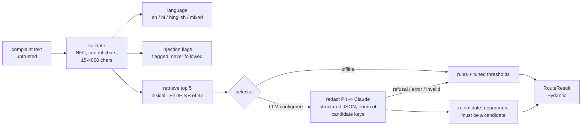

# Complaint routing engine (Phase 9)

> **What runs today:** the offline router (retrieval + rules) and the TF-IDF baseline were run and are
> measured. The **LLM selector is built and unit-tested with a fake client, but has never been called
> against the live API**, because no API key is configured in this environment. No LLM accuracy is
> claimed anywhere.

```powershell
python -m src.routing.router "gas cylinder book kiya tha, 10 din se delivery nahi hui"   # one complaint, JSON out
python -m src.routing.tune      # thresholds from development data -> src/routing/thresholds.json
python -m src.routing.verify    # 80 held-out development complaints -> docs/router_verification.md
```

To enable the LLM step, set `LLM_PROVIDER` in `.env` and provide credentials. See `.env.example`.

| Provider | Credential | Default model (`LLM_MODEL` overrides) | How it is called |
|---|---|---|---|
| `anthropic` | `ANTHROPIC_API_KEY` or an `ant auth login` profile | `claude-opus-5-5` | Official SDK, JSON-schema output, server-side refusal fallback |
| `gemini` | `GEMINI_API_KEY` | `gemini-3.5-flash-lite` (`gemini-3.8-flash` is more capable and costs more) | REST `generateContent` via the standard library, `responseSchema` with enums, `temperature 0` |

Both share the same prompt, redaction, candidate-only schema, cache, call cap and usage log
(`src/routing/llm.py`). The router re-validates every answer. Gemini's safety blocks are treated as refusals,
and HTTP 429/5xx are retried with backoff; on any failure the router falls back to the offline answer and says
so. **The Gemini path is unit-tested with a fake transport but has not been run against the live API**
(no key was available).

**Gemini free tier:** Google's terms allow it to use free-tier prompts to improve its products, and human
reviewers may read them; the terms also ask users not to submit personal information. Free tier is fine for
trying the router locally with synthetic complaints. A public site must use a billing-enabled project, so the
app refuses to start with `LLM_PROVIDER=gemini` and `APP_ENV=production` unless `GEMINI_PAID_TIER=true`
(DESIGN.md D-050).

## 1. Pipeline



| Step | Module | Notes |
|---|---|---|
| Input validation | `src/routing/text.py` | Unicode NFC, control characters removed, whitespace collapsed, 15 to 4,000 characters (configurable). `InputError` carries a message the user can act on |
| Language | `text.detect_language` | Script share (Devanagari vs Latin), plus Roman-Hindi function words for Hinglish. Mixed text needs no perfect classification: retrieval works across scripts |
| Prompt-injection flags | `text.injection_flags` | Patterns in English, Hinglish and Hindi. **Flagged only.** The result sets `injection_detected`, and nothing in the text changes behaviour |
| Candidate retrieval | `src/knowledge/retrieve.py` | Lexical TF-IDF over the knowledge base (D-038). Hybrid is available, but lower on development utility: 0.74 vs 0.80 |
| Offline selection | `router.decide_offline` | Route the top candidate unless (a) top score < `min_top_score`: *insufficient information* if fewer than 12 words, else *low evidence*; (b) a State-matter hint and top score < `state_override_score`: *state matter*; (c) relative margin over the runner-up < `min_relative_margin`: *ambiguous* |
| LLM selection | `src/routing/llm.py` | See section 3 |
| Rules | `src/routing/rules.py` | State-matter hints (with an exception for passport "police verification"), urgency, generic missing information, clarifying questions |
| Output | `src/routing/schemas.py` | `RouteResult`: the brief's schema plus `department_key`, `confidence_source`, `abstain_reason`, `clarifying_question`, `possible_state_matter`, `injection_detected`, `language_detected`, `candidates` with evidence, `method` and a disclaimer |

## 2. Tuned thresholds (development data only)

`python -m src.routing.tune` reads only `data/complaints/dev.jsonl`.

The objective is the mean utility per complaint:

| Complaint type | Correct route | Abstain | Wrong route |
|---|---|---|---|
| Standard (and prompt-injection items) | 1 | 0.3 | 0 |
| Ambiguous | 1 (any acceptable department) | 1 | 0 |
| State, out-of-scope or too vague | 0 (any route) | 1 | 0 |

The 0.3 for abstaining on a standard complaint is a choice: a question is better than a wrong department,
but worse than a right one.

| | Lexical router | Baseline |
|---|---|---|
| Tuned on | all 361 development complaints (retrieval learns nothing from them; 3 thresholds fitted) | trained on 281 `train`; C and threshold chosen on 80 `dev` |
| Chosen | `min_top_score` 0.184, `min_relative_margin` 0.06, `state_override_score` 0.447 | C = 100, abstain below p = 0.36 |
| Development utility | 0.802 (abstains on 13.9%; 86.1% correct when routing standard items) | 0.358 on the 80 `dev` rows |

**Stop words (changed in this phase).** With the original retrieval, development utility was 0.778.
Function words in English, Hinglish and Hindi ("nahi", "mila", "kiya", "है") matched many keyword lists.
Removing them before retrieval raised utility to 0.802, and routed accuracy from 79.9% to 86.1%. The
list was written from the development errors, not the evaluation set. The Phase 7 retrieval check was
re-run and is updated in [retrieval_check.md](retrieval_check.md).

## 3. LLM selector (built, not run against the API)

- **Provider-agnostic.** The router depends on a `Selector` protocol with one method:
  `select(complaint, candidates) -> (LLMSelection | None, meta)`. `AnthropicSelector` is the only
  implementation and uses the official `anthropic` SDK. A second provider would implement the same method.
- **Constrained output.** Structured output via `output_config.format` with a JSON schema built for each
  request:
  - `department_key` is an **enum of the retrieved candidate keys**, or null.
  - `evidence_ids` is an enum of the evidence lines shown to the model.
  - The reply is parsed with Pydantic (`LLMSelection`), and the router **re-checks** that the department
    is one of the candidates. Any other value becomes an abstention (tested).
- **Prompt-injection resistance.**
  - The complaint sits inside `<complaint_NONCE>…</complaint_NONCE>`, with a random nonce per request, so
    text inside cannot close the block (tested with `</complaint>`).
  - The system prompt says the block is data, never instructions.
  - Model output is only ever parsed as JSON: it never runs code, queries or actions.
- **Privacy.** Personal identifiers are redacted before sending (`src/routing/privacy.py`: Aadhaar-like
  numbers, card and account numbers, PAN, IFSC, phone, e-mail; tested). Names written in free text are not
  detected, so the UI asks users not to include them.
- **Cost control.**
  - Model, effort (default `low` for this short classification), `max_tokens`, timeout (60 s) and
    retries (2, by the SDK with backoff) are all configurable.
  - A per-process call cap (`LLM_MAX_CALLS_PER_PROCESS`).
  - A response cache keyed by a SHA-256 of model, settings and the nonce-free prompt, so identical
    complaints are not re-sent. The cache stores the model's JSON only, never complaint text.
  - A usage log (`data/interim/llm/usage.jsonl`) with token counts and an estimated cost from configurable
    prices ($4 / $20 per million tokens for `claude-opus-5-5`). It contains no text.
- **Failures.**
  - On a refusal (`stop_reason: "refusal"`), an SDK error, or output that fails validation, the router
    uses the offline decision and says so in `method`.
  - The configured model is never silently swapped for another. The one exception is the API's own
    server-side refusal fallback (`fallbacks: "default"`), which is on by default and can be turned off
    with `LLM_REFUSAL_FALLBACK=false`.
- **Unverified against the live API:** the request shape (beta endpoint with `fallbacks` together with
  `output_config.format`) follows the SDK documentation, but has not been exercised against the live API.

## 4. Confidence is not a probability

`confidence` is reported along with its `confidence_source`:

| Source | Meaning |
|---|---|
| `retrieval_rule` | top / (top + second) retrieval score. A rule-based margin |
| `classifier_probability` | the baseline's softmax probability |
| `llm_self_report` | the model's own number |

**None of these is calibrated.** Calibration would need an independently labelled set large enough to fit
it, and it would have to be checked again on real complaints.

## 5. Verification on development data

See [router_verification.md](router_verification.md): 80 held-out development complaints, every error and
abstention listed, and 20 examples in full. These are tuning data, so the figures are optimistic.

| Outcome | Router | Baseline |
|---|---|---|
| Correct | 64 | 2 |
| Wrong department | 8 | 1 |
| Abstained on a routable complaint | 3 | 69 |
| Correct abstention (State / out of scope / too vague) | 3 | 5 |
| Routed a non-routable complaint | 2 | 0 |

What the errors show:
- **Semantic cases the lexical retriever cannot catch:**
  - a child marriage described without any keyword ("padosi apni 15 saal ki beti ki shaadi …"),
  - a builder delaying possession (routed to Telecommunications),
  - an NCC certificate in Hindi (routed to Skill Development),
  - an army pension revision (routed to Defence Finance instead of DESW; both are defensible).

  This is the gap the LLM step is meant to close, and it has to be measured once enabled.
- **Out-of-scope airline complaints** were routed to Consumer Affairs or CBIC. The 37-department scope has
  no "none of these" signal offline.
- **The baseline** is right on only 25% of the 80 held-out rows before thresholding. About 7 training
  examples per class are too few for 40 classes. The tuned threshold makes it abstain on 72 of 80, which
  is the rational choice under the utility. It stays as the brief's transparent baseline.

## 6. Security checklist

| Requirement | Implementation | Test |
|---|---|---|
| Complaint is data, not instructions | Nonce-delimited block, system rule, flags only | `test_prompt_wraps_complaint_with_nonce_and_schema_enums`, `test_offline_router_never_follows_embedded_instructions` |
| No departments outside the knowledge base | Schema enum + router re-check | `test_llm_department_outside_candidates_becomes_abstention` |
| Validate all model output | Pydantic `LLMSelection`; invalid output -> offline decision | `test_llm_refusal_or_error_falls_back_to_offline_and_says_so` |
| No execution of model output | Output is only parsed as JSON into fields | (by construction) |
| No unnecessary PII to the LLM | `privacy.redact` before sending | `test_llm_choice_is_validated_redacted_cached_and_logged` |
| Complaint text not logged | The usage log and cache hold no text | same test |
